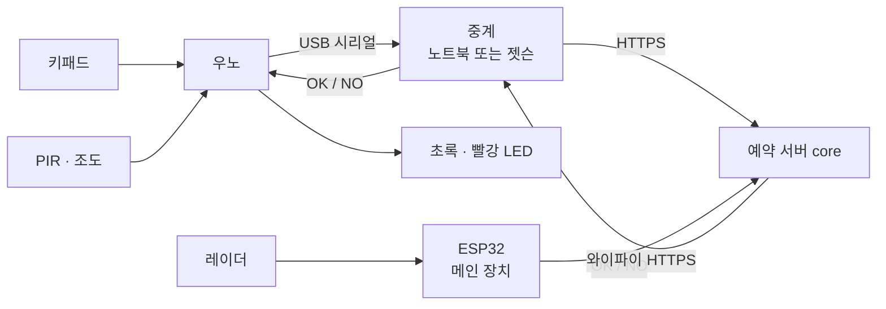
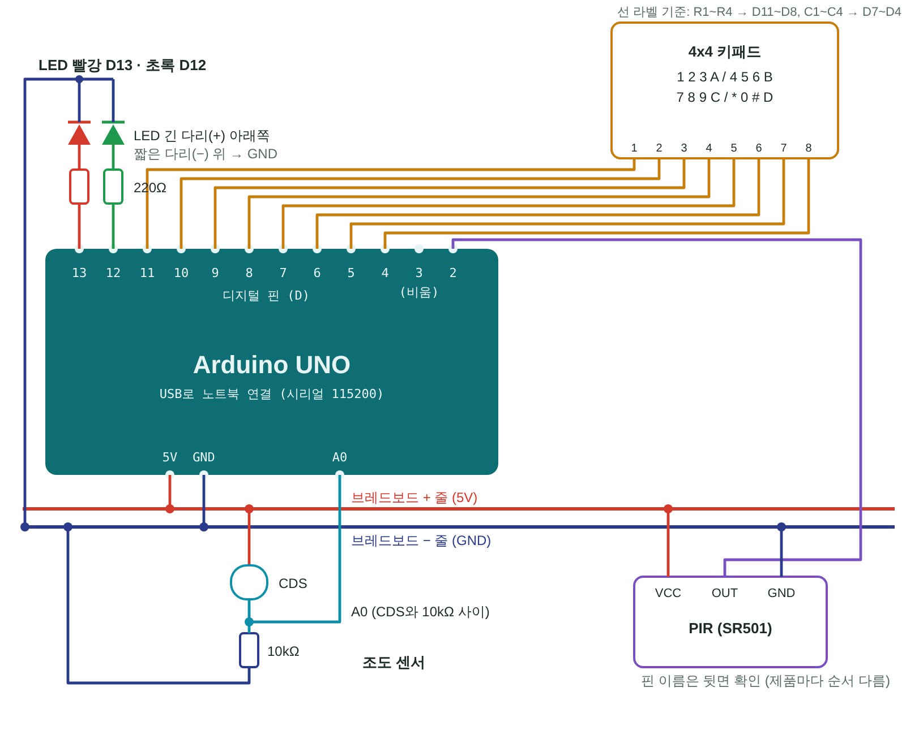
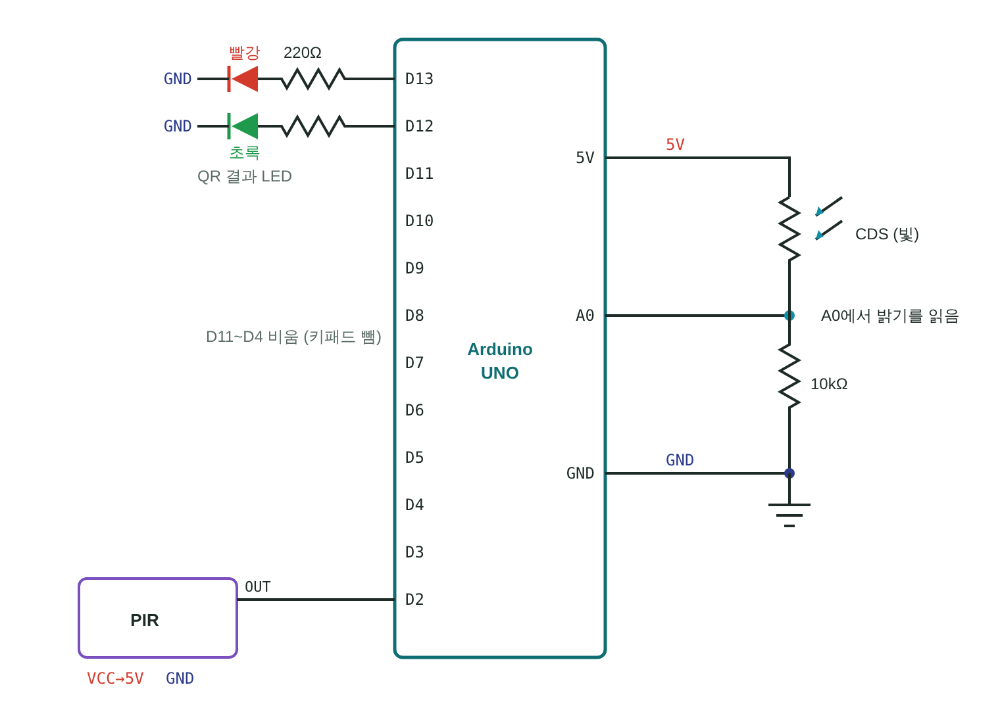
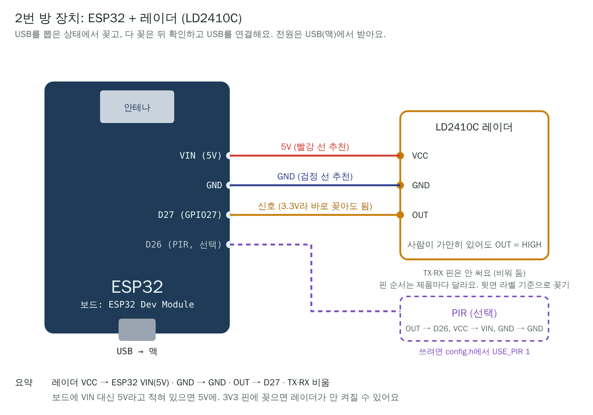

# mspace-device

M-SPACE 디바이스·센서 서비스예요. **문 앞 키패드 체크인**과 **방 안 재실 센서**를 맡아요.

- 담당: 수연
- 팀 공통 문서: [AI-go-do/docs](https://github.com/AI-go-do/docs) (요구사항·컨벤션·인프라)

## 1. 관련 요구사항

| ID | 내용 | 버전 |
|---|---|---|
| FR-ACC-001 | 6자리 번호 → 키패드 체크인 | v0.1 |
| FR-DEV-101 | 재실 센서 값 수집 (레이더·조도·CO2 → 서버) | v0.2 |
| FR-DEV-102 | 방 현황 화면 (지금 비었는지, 다음 예약) | v0.2 |
| FR-DEV-103 | 자리 비움 자동 퇴실 (10분 비면 알림, 15분이면 퇴실. 앱의 "아직 있어요"는 예약당 1번, 누른 뒤 10분 비면 퇴실) | v0.2 |
| FR-DEV-104 | 환기 알림 (CO2 1000ppm) | 확장 |

## 2. 전체 구조



- 우노는 와이파이가 없어서 USB로 노트북에 보내고, 노트북(`gateway/gateway.py`)이 서버에 대신 전달해요.
- **ESP32가 메인 장치예요.** 노트북 없이 ESP32 → 서버로 바로 보내요. 보내는 형식이 같아서 서버는 바뀌지 않아요. 지금은 우노+젯슨(1번 방)과 ESP32(2번 방)를 같이 시험해요.
- 번호가 맞는지는 **서버만 판단**해요. 장치는 번호를 저장하지 않고, 입력을 보내고 결과를 표시만 해요.

## 3. 진행 단계

- [ ] **0. 준비:** 아두이노 IDE, Keypad 라이브러리, 우노 업로드 확인
- [ ] **1. 키패드 체크인 (FR-ACC-001):** 6자리 + `#` 입력 → 서버 확인 → LED
- [ ] **2. 센서 수집 (FR-DEV-101):** PIR·조도 값 전송, eventId 중복 제거 (코드 준비됨, DRY_RUN 확인 남음)
- [ ] **3. 레이더 + ESP32:** 가만히 있는 사람 감지, 와이파이 직접 전송
- [ ] **4. 재실 판정:** 장치는 있음/없음만 보내고 10·15분 판단은 core가 해요. 헷갈리면 "있음". PIR / 레이더 / 둘 다 정확도 비교
- [ ] **5. 방 현황 (FR-DEV-102):** 방별 비었음/사용 중 + 다음 예약
- [ ] **6. 자리 비움 (FR-DEV-103):** 장치가 보낸 재실로 core가 10분 알림·15분 퇴실 (아직 있어요는 앱 버튼)
- [ ] **7. 확장:** 아래 8절

## 4. 배선도 · 회로도

**꽂기 전에 (고장 안 나게)**
1. USB를 뽑은 상태에서 배선하고, 다 꽂은 뒤 확인하고 연결해요.
2. 5V와 GND를 직접 잇지 않아요 (합선).
3. LED는 꼭 220Ω 저항을 거쳐요. 긴 다리(+)가 핀 쪽, 짧은 다리(−)가 GND 쪽이에요.
4. D0, D1은 비워 둬요. 노트북과 시리얼로 대화하는 핀이에요.
5. 부품은 하나씩 추가하고, 추가할 때마다 시리얼 모니터로 확인해요.

**배선도** (어디에 꽂나)



**회로도** (무엇이 무엇과 이어지나)



| 부품 | 우노 핀 |
|---|---|
| 키패드 행 R1~R4 | D11, D10, D9, D8 |
| 키패드 열 C1~C4 | D7, D6, D5, D4 |
| 초록 LED (맞음) | D12 → 220Ω → LED → GND |
| 빨강 LED (틀림) | D13 → 220Ω → LED → GND |
| PIR (SR501) | VCC → 5V, GND → GND, OUT → **D2** |
| 조도 (CDS) | 5V → CDS → **A0** → 10kΩ → GND (CDS와 10kΩ 사이를 A0에) |
| 레이더 (LD2410C) | 우노가 아니라 **ESP32**에 달아요 (아래 "ESP32 방 장치") |

키패드 선에 `R1`·`C1` 같은 라벨이 있으면 왼쪽부터 순서대로가 아니라 **라벨 기준**으로 꽂아요 (C4~C1, R1~R4 순서인 키패드도 있어요).
키패드를 눌렀는데 다른 숫자가 찍히면 선을 바꾸지 말고 코드의 `rowPins`, `colPins` 순서만 바꿔요.

## 5. 실행 방법

1. 아두이노 IDE → 라이브러리 관리 → **Keypad** (Mark Stanley) 설치
2. `firmware/uno_sensor_node/uno_sensor_node.ino` 업로드
3. 시리얼 모니터(115200)에서 `123456#` 입력 → keypad JSON이 찍히는지 확인 → **모니터를 닫아요** (중계와 포트를 같이 못 써요)
4. 중계 실행
   ```bash
   pip3 install -r gateway/requirements.txt
   DRY_RUN=1 python3 gateway/gateway.py              # 서버 없이 테스트: 123456#만 초록
   echo 'DEVICE_TOKEN=<받은 장치 토큰>' > .env   # 토큰은 .env에만 (저장소에 안 올라가요)
   set -a; . ./.env; set +a                          # .env 값을 불러오기
   SERVER=https://dev-mspace.java21.net python3 gateway/gateway.py   # 토큰이 실리므로 원격 서버는 https만
   SEND_SENSORS=1 SERVER=https://dev-mspace.java21.net python3 gateway/gateway.py   # 재실 센서도 core로 보내기
   ```
   재실 센서 전송(`SEND_SENSORS=1`)은 core에 `/api/sensor-events`(core #60)가 올라간 뒤 켜요. 키패드를 막지 않게 뒤에서 보내고, 끊기거나 토큰·경로 문제(401·403·404)면 모아 뒀다가 다시 보내요(최대 360개, 약 1시간). 이벤트 자체가 틀린 것(400·409·413·422)만 버려요.
   포트는 자동으로 찾아요. 못 찾으면 `PORT=/dev/ttyACM0`처럼 지정해요.
   서버에는 `Authorization: Bearer <장치 토큰>` 헤더로 보내요. 토큰이 없으면 DRY_RUN만 돼요.
   `http://`는 내 컴퓨터에 띄운 core 테스트에서만 써요. 원격 주소에 `http://`를 쓰면 게이트웨이가 시작하지 않아요(토큰 보호).

### QR 입실 (문 앞 웹캠, 시연용)

8차 회의(11/6)에서 시연을 **카메라 + QR**로 바꿨어요. 키패드는 "1차 시도"로 그대로 두고, 같은 서버 확인(`/api/access/verify`)을 QR로도 해요.

```bash
ls /dev/video*                                    # 웹캠 번호 확인 (보통 0)
set -a; . ./.env; set +a
QR_CAMERA=0 SEND_SENSORS=1 python3 gateway/gateway.py          # 진짜 서버
DRY_RUN=1 QR_CAMERA=0 python3 gateway/gateway.py               # 서버 없이: 123456 QR만 초록
```

- 흐름: 폰에 QR 띄우기 → 문 앞 웹캠에 비추기 → 젯슨이 읽어 core에 확인 → 우노 LED 초록/빨강 (키패드와 같은 LED)
- QR 안의 글자: 입실 번호 6자리(`123456`) 또는 방까지 넣은 `MSPACE:1:123456`. 방 번호는 `QR_ROOM_ID`(기본 1). 다른 방 QR은 서버에 묻지 않고 거부
- 지금은 예약 때 받은 6자리 번호를 QR로 만들어 비춰요 (QR 만들기 사이트나 앱). 나중에 웹 입실 화면이 QR을 바로 띄우고, core가 "30초마다 바뀌는 코드"를 주면 `qr_door.py`의 `parse_qr()`만 바꾸면 돼요
- 같은 QR을 계속 비추면 5초 동안은 다시 묻지 않아요
- **사진·영상은 저장하지도 보내지도 않아요.** 읽은 글자만 써요
- OpenCV(`cv2`)는 젯슨에 기본으로 깔려 있어요. 없다고 나오면 `sudo apt install python3-opencv`

### 방 안 카메라 (인원 세기 · 정리 확인, 시연용)

방 안을 비추는 두 번째 웹캠으로 **몇 명 있는지** 세고, 사람이 다 나가면 **방이 깨끗한지** 확인해요.

```bash
# 처음 한 번: 사람·물건 찾는 모델 받기 (yolov8n.onnx, 약 12MB)
pip3 install ultralytics && yolo export model=yolov8n.pt format=onnx
mv yolov8n.onnx gateway/

# 젯슨 기본 OpenCV(4.6)는 YOLOv8 모델을 못 읽어서 onnxruntime을 같이 써요 (처음 한 번)
sudo apt install -y python3-opencv python3-numpy python3-venv
python3 -m venv --system-site-packages ~/mspace-venv     # apt로 깐 OpenCV·serial은 그대로 씀
~/mspace-venv/bin/pip install onnxruntime

set -a; . ./.env; set +a
ROOM_CAMERA=2 YOLO_MODEL=gateway/yolov8n.onnx SEND_SENSORS=1 ~/mspace-venv/bin/python gateway/gateway.py
# 문 앞 QR과 같이: QR_CAMERA=0 ROOM_CAMERA=1 ...
# 서버 없이 화면 출력만: DRY_RUN=1 ROOM_CAMERA=1 YOLO_MODEL=gateway/yolov8n.onnx python3 gateway/gateway.py
```

- 인원 수: 1초마다 사람 수를 세고, 최근 5번의 가운데 값을 써요(한 번 잘못 센 건 무시). 바뀌면 바로, 아니면 10초마다 기존 재실 API(`kind: OCCUPANCY`)로 보내요. `sources`에 `"people": 2`가 들어가서 **core를 안 바꿔도** 돼요
- 그 방은 카메라가 재실을 대신 보내요. 우노 PIR 값은 버리지 않고 `occupied`(사람 수 > 0 **또는** PIR)와 `sources.pir`에 합쳐요
- 정리 확인: 사람이 있다가 다 나가고 30초가 지나면 한 번 봐요. 처음 본 빈 방과 비교해서 새로 생긴 컵·병 같은 쓰레기는 `NEEDS_CLEANING`, 노트북·가방·폰 같은 두고 간 물건은 `LEFT_ITEMS`, 없으면 `CLEAN`이에요
- 결과는 화면에 출력하고 `room_checks.jsonl`에 한 줄씩 남겨요. core에 결과 받는 API가 생기면 거기로 보내면 돼요
- 방 번호는 `ROOM_CAMERA_ROOM`(기본 1), 카메라 번호는 `ROOM_CAMERA`. 웹캠 하나에 번호가 여러 개 잡히니 `v4l2-ctl --list-devices`로 확인해요 (11/6 젯슨 B: C920=0 문 앞, BRIO=2 방 안)
- 모델이 없으면 OpenCV 기본 사람 찾기(HOG)로 사람 수만 세요. 정리 확인은 꺼져요
- **사진·영상은 저장하지도 보내지도 않아요.** 한 장 보고 바로 지우고, 숫자와 물건 이름만 남겨요
- **쓰러짐 감지(이상 탐지)**: 사람 상자가 세로보다 가로가 넓으면(누운 자세) 그 자리를 기억하고, 거의 안 움직인 채 `FALL_SEC`(기본 15초, 0이면 끔)가 지나면 `⚠ 이상 탐지`를 띄워요. core에 알림 API가 없어서 재실 이벤트 `sources.alert = "FALL_SUSPECTED"`로 남기고, 일어나면 `FALL_CLEARED`. `room_checks.jsonl`에도 기록. 카메라를 위에서 비스듬히 달면 서 있는 사람도 넓게 보일 수 있어서 `LYING_RATIO`(room_camera.py)를 설치 각도에 맞춰요
- **우노 없이 카메라만**: 우노가 안 꽂혀 있어도 `QR_CAMERA`나 `ROOM_CAMERA`를 켜면 카메라만 돌아가요. QR 결과는 LED 대신 화면에 "초록(열림)/빨강(거부)"로 나와요

### 젯슨에서 올리기 (맥 IDE가 안 될 때)

```bash
~/bin/arduino-cli compile -b arduino:avr:uno firmware/uno_sensor_node
~/bin/arduino-cli upload -p /dev/ttyUSB0 -b arduino:avr:uno firmware/uno_sensor_node
```
호환 우노(CH340 칩)는 `ch341` 드라이버가 필요해요. 재부팅해도 켜지게 하려면 한 번만:
```bash
sudo mkdir -p /lib/modules/$(uname -r)/kernel/drivers/usb/serial
sudo cp ~/ch341/ch341.ko /lib/modules/$(uname -r)/kernel/drivers/usb/serial/
sudo depmod -a
echo ch341 | sudo tee /etc/modules-load.d/ch341.conf
```

### 재실 센서 확인 (PIR · 조도)

1. PIR 뒤 주황 손잡이: 시간(Tx)은 제일 짧게, 감도(Sx)는 가운데. 점퍼는 **H**(움직이는 동안 계속 켜짐). L이면 움직여도 있음↔없음이 반복돼요
2. 켜고 **1분쯤** 기다려요. PIR은 켜진 직후 1분 정도 값이 들쭉날쭉해요
3. `DRY_RUN=1 python3 gateway/gateway.py` 실행 후
   - 손을 흔들면 `재실 1번 방: 있음 (pir=1, ...)`. 그 뒤 가만히 있어도 **2분 동안은 있음**이에요 (`PIR_HOLD_MS`). PIR은 움직임만 봐서, 공부하며 가만히 있는 사람을 "없음"으로 보지 않게 한 거예요
   - 조도 센서를 손으로 가리면 `조도=` 숫자가 작아져요
   - 가만히 두어도 10초마다 한 줄씩 나와요 (살아 있다는 신호)
4. `[DRY_RUN] POST /api/sensor-events` 뒤에 core로 보낼 모양이 그대로 찍혀요
   - 조도가 가려도 계속 `1023`이면 10kΩ 저항이 GND(− 줄)에 안 이어진 거예요. A0 선은 조도 센서와 저항이 만나는 줄에 꽂아요

### ESP32 방 장치 (메인, 지금은 2번 방)

실제로 쓸 장치는 ESP32예요. 방마다 하나씩 달고, 젯슨 없이 와이파이로 core에 바로 보내요. 지금은 우노+젯슨이 1번 방, ESP32가 2번 방이에요 (`config.h`의 `ROOM_ID`).

**배선** ([docs/wiring-esp32.png](docs/wiring-esp32.png))



| LD2410C 레이더 | ESP32 |
|---|---|
| VCC | VIN (5V) |
| GND | GND |
| OUT | D27 |
| TX · RX | 비움 |

**올리기**
1. 아두이노 IDE → 보드 매니저 → **esp32** (Espressif) 설치, 보드는 `ESP32 Dev Module`
2. `firmware/esp32_room_node/esp32_room_node.ino` 열기 (같은 폴더 파일이 탭으로 같이 열려요) → 업로드
3. 시리얼 모니터(115200): 레이더 앞에 서면 `재실 2번 방: 있음 (레이더=1)`, 그대로여도 10초마다 한 줄 + `[DRY_RUN] POST ...`

**와이파이·서버 (준비되면)**
1. `secrets.h.example`을 `secrets.h`로 복사해서 와이파이(2.4GHz), 서버 주소, 장치 토큰, 인증서 넣기. **GitHub에 안 올라가요**
2. `config.h`에서 `DRY_RUN 0`
3. 안전장치: 토큰이나 https 인증서가 없으면 보내지 않아요. 원격 `http://`도 막아요(맥 로컬 시험만 `ALLOW_HTTP_FOR_LOCAL_TEST 1`, 이때도 사설 주소 192.168.x.x·10.x·172.16~31.x나 `.local`만 허용)

**파일 (역할별)**

| 파일 | 하는 일 |
|---|---|
| `config.h` | 방 번호, 핀, 어떤 센서를 달았나(`USE_RADAR`, `USE_PIR`), 주기, DRY_RUN |
| `secrets.h` | 와이파이·서버 주소·토큰 (복사해서 만듦) |
| `occupancy.*` | 레이더·PIR 읽기 → "하나라도 있음이면 있음"으로 합치기, 바뀜/10초 판단 |
| `events.*` | core 형식 이벤트 (새 UUID eventId, 센서가 본 시각 observedAt) |
| `net.*` | 와이파이 연결·자동 재연결, 인터넷 시계 |
| `sender.*` | 큐에 모아 순서대로 전송. 5xx·연결 실패·401·403·404·408·429·리디렉션은 큐를 그대로 두고 같은 eventId로 재시도(1→2→4…30초). 400·409·413·422(이 이벤트 형식 문제)만 버림. 시계(NTP)를 기다리는 동안 1분마다 로그 |

큐는 32개(10초 신호 기준 약 5분)까지 모아요. 와이파이가 5분 넘게 끊기면 그 사이 기록은 오래된 것부터 일부 빠져요(정확도 측정 #13 때 참고). core는 다시 받은 시각부터 10·15분을 새로 재요.

**ESP32 확장 (나중에 붙일 자리)**

| 기능 | 할 일 |
|---|---|
| PIR 같이 달기 (정확도 비교, 이슈 #13) | `USE_PIR 1`, OUT → D26. 코드는 이미 있음 |
| CO2 (FR-DEV-104) | SCD40 읽는 파일 추가 → 1분마다 `makeCo2Event()`로 큐에 넣기. 보내는 쪽은 그대로 |
| 키패드 체크인 (FR-ACC-001) | 우노 코드의 키패드·LED 부분을 옮기고, `/api/access/verify`로 보내는 함수 추가 |
| 방 늘리기 | 같은 코드에 `ROOM_ID`·`DEVICE_ID`·토큰만 바꿔서 올리기 |

### 게이트웨이 구조

역할별로 나눠서, 하나를 바꿔도 나머지는 그대로예요.

| 부품 | 하는 일 |
|---|---|
| `Config`, `load_config()` | 설정값(서버 주소, DRY_RUN, 토큰, 포트)을 한곳에 모음 |
| `find_port()` | 우노가 꽂힌 USB 포트 찾기 |
| `DryRunVerifier` / `HttpVerifier` | 번호 확인기. 같은 `verify(body)` 모양이라 연습용·진짜 서버를 바꿔 끼움 |
| `handle_line()` + `HANDLERS` | 한 줄을 받아 `sensorType`별 처리기로 보냄 (`keypad`, `occupancy`) |
| `handle_occupancy()` | 우노 재실 줄을 core 형식(`kind: OCCUPANCY`, `occupied`, `sources`, `observedAt`)으로 바꿈 |
| `main()` | 위 부품을 조립하고 시리얼을 계속 읽음 |
| `qr_door.py` | 문 앞 웹캠 QR 입실 (`QR_CAMERA`). `QrDoor`가 QR 글자 → 같은 확인기 → OK/NO, `run_camera()`가 카메라에서 QR을 찾음 |
| `room_camera.py` | 방 안 웹캠 (`ROOM_CAMERA`). `RoomWatcher`가 사람 수 → 재실 이벤트, 빈 방이 되면 정리 확인. `YoloDetector`(모델 있을 때) / `HogPersonDetector`(없을 때) |

### 테스트

```bash
pip3 install -r gateway/requirements-dev.txt
pytest --cov --cov-report=term-missing   # 우노·서버 없이 가짜 시리얼로 게이트웨이를 확인해요
```

### CI (PR마다 자동)

| 확인 | 내용 | 합치기 조건 |
|---|---|---|
| `test` | 게이트웨이 테스트 + 커버리지 | develop · main 모두 통과해야 함 |
| `firmware` | 우노 펌웨어 컴파일 (Keypad 포함) | develop · main 모두 통과해야 함 |
| `sonar` | 학교 SonarQube 서버 분석 (Secrets: `SONAR_HOST_URL`, `SONAR_TOKEN`) | develop은 결과 표시만, **main은 새 코드 커버리지 80% 이상** (품질 게이트) |
| CodeRabbit | AI 리뷰 (한국어) | 참고용. 팀원 1명 승인은 따로 필요 |

## 6. 이벤트 형식과 eventId

```json
{"eventId":"1-48213-18","roomId":1,"sensorType":"keypad","code":"123456","ms":12890}
{"eventId":"1-48213-19","roomId":1,"sensorType":"occupancy","pir":1,"light":512,"ms":13000}
```

- `eventId` = 방 번호 - 부팅 횟수 - 순서
- 와이파이가 끊겨 중계가 같은 이벤트를 다시 보내도(최대 2번) 서버가 같은 eventId는 **한 번만 저장**해요 (중복 제거)
- 가운데 부팅 횟수는 우노 EEPROM(전원을 꺼도 남는 메모리)에 저장돼서, 우노를 껐다 켜서 순서가 0부터 다시 시작해도 번호가 겹치지 않게 해요. 새 보드는 랜덤한 큰 수에서 시작해서 보드를 바꿔도 예전 번호와 겹치지 않아요
- 서버에는 이 값을 **UUID로 바꿔서** 보내요 (uuid5). 같은 입력이면 항상 같은 UUID라서 재전송해도 중복 제거가 그대로 돼요

## 7. 서버와 맞출 것 (core 지영님, 토큰 재웅님)

> 자세한 형식과 확인할 것 목록은 [docs/access-api.md](docs/access-api.md)에 있어요.

**출입 확인 (지영님 형식에 맞춤)**

```json
요청: {"eventId": "uuid", "roomId": 1, "deviceId": "keypad-1", "code": "123456"}
응답: {"result": "OPENED"}  또는  {"result": "DENIED", "reason": "WRONG_CODE"}
```

`#`을 누르면 답이 올 때까지 **초록 LED가 깜빡여요(확인 중)**. 깜빡이는 동안 누른 `#`은 무시해요. 중계는 `OPENED`일 때만 초록 LED, 그 밖에는(서버 응답 없음 포함) 빨간 LED를 켜요. 우노가 9초 넘게 답을 못 받으면(USB 빠짐 등) 스스로 빨간 LED를 켜요. 거부 이유는 로그에 남겨요.

| 아직 정할 것 | 내용 |
|---|---|
| `POST /api/access/verify` | 장치 토큰 발급, 개발 서버 HTTPS 주소 (재웅) |
| `POST /api/sensor-events` | 형식 초안 [docs/sensor-events-api.md](docs/sensor-events-api.md). core에 둘지, 응답·끊김 기준 (지영), 센서 장치 토큰 (재웅) |

## 8. 확장 계획

지금 구조는 **장비만 붙이면 동작하게** 만들어 뒀어요. 같은 이벤트 형식과 같은 API를 쓰기 때문이에요.

| 확장 | 붙일 것 | 바뀌는 곳 |
|---|---|---|
| 환기 알림 (FR-DEV-104) | CO2 센서 (SCD40) | 장치 코드에 센서 읽기만 추가 |
| 실제 도어락 · QR | 릴레이 + 잠금장치, QR 리더 | 같은 `/api/access/verify`를 부르는 장치만 교체 |
| 방마다 설치 | ESP32 + 센서 세트 | 방 번호(`ROOM_ID`)만 바꿔서 복제 |
| 환기 예측 | 젯슨 | CO2 기록으로 "곧 환기 필요" 미리 알림 (팀 결정 대기, Q-10) |

## 폴더 구조

```
firmware/uno_sensor_node/   우노 코드 (키패드 · PIR · 조도) → 1번 방
firmware/esp32_room_node/   ESP32 메인 장치 (레이더 → 와이파이로 core 직접) → 2번 방
gateway/                    중계 (노트북·젯슨)
docs/                       배선도·회로도 (png, svg)
```
