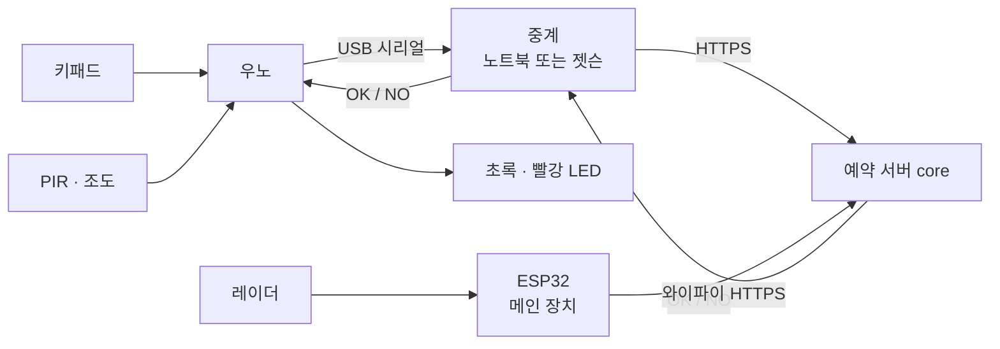

# mspace-device

M-SPACE 디바이스·센서 서비스예요. **문 앞 키패드 체크인**과 **방 안 재실 센서**를 맡아요.

- 담당: 수연
- 팀 공통 문서: [AI-go-do/docs](https://github.com/AI-go-do/docs) (요구사항·컨벤션·인프라)

## 1. 관련 요구사항

| ID | 내용 | 버전 |
|---|---|---|
| FR-ACC-001 | 6자리 번호 → 키패드 체크인 | v0.1 |
| FR-DEV-101 | 재실 센서 값 수집 (레이더·조도·CO2 → 서버) | v0.2 |
| FR-DEV-102 | 방 현황 화면 (지금 비었는지, 다음 예약) | v0.2 |
| FR-DEV-103 | 자리 비움 자동 퇴실 (10분 비면 알림, 15분이면 퇴실. 앱의 "아직 있어요"는 예약당 1번, 누른 뒤 10분 비면 퇴실) | v0.2 |
| FR-DEV-104 | 환기 알림 (CO2 1000ppm) | 확장 |

## 2. 전체 구조



- 우노는 와이파이가 없어서 USB로 노트북에 보내고, 노트북(`gateway/gateway.py`)이 서버에 대신 전달해요.
- **ESP32가 메인 장치예요.** 노트북 없이 ESP32 → 서버로 바로 보내요. 보내는 형식이 같아서 서버는 바뀌지 않아요. 지금은 우노+젯슨(1번 방)과 ESP32(2번 방)를 같이 시험해요.
- 번호가 맞는지는 **서버만 판단**해요. 장치는 번호를 저장하지 않고, 입력을 보내고 결과를 표시만 해요.

## 3. 진행 단계

- [ ] **0. 준비:** 아두이노 IDE, Keypad 라이브러리, 우노 업로드 확인
- [ ] **1. 키패드 체크인 (FR-ACC-001):** 6자리 + `#` 입력 → 서버 확인 → LED
- [ ] **2. 센서 수집 (FR-DEV-101):** PIR·조도 값 전송, eventId 중복 제거 (코드 준비됨, DRY_RUN 확인 남음)
- [ ] **3. 레이더 + ESP32:** 가만히 있는 사람 감지, 와이파이 직접 전송
- [ ] **4. 재실 판정:** 장치는 있음/없음만 보내고 10·15분 판단은 core가 해요. 헷갈리면 "있음". PIR / 레이더 / 둘 다 정확도 비교
- [ ] **5. 방 현황 (FR-DEV-102):** 방별 비었음/사용 중 + 다음 예약
- [ ] **6. 자리 비움 (FR-DEV-103):** 장치가 보낸 재실로 core가 10분 알림·15분 퇴실 (아직 있어요는 앱 버튼)
- [ ] **7. 확장:** 아래 8절

## 4. 배선도 · 회로도

**꽂기 전에 (고장 안 나게)**
1. USB를 뽑은 상태에서 배선하고, 다 꽂은 뒤 확인하고 연결해요.
2. 5V와 GND를 직접 잇지 않아요 (합선).
3. LED는 꼭 220Ω 저항을 거쳐요. 긴 다리(+)가 핀 쪽, 짧은 다리(−)가 GND 쪽이에요.
4. D0, D1은 비워 둬요. 노트북과 시리얼로 대화하는 핀이에요.
5. 부품은 하나씩 추가하고, 추가할 때마다 시리얼 모니터로 확인해요.

**배선도** (어디에 꽂나)


**회로도** (무엇이 무엇과 이어지나)


| 부품 | 우노 핀 |
|---|---|
| 키패드 행 R1~R4 | D11, D10, D9, D8 |
| 키패드 열 C1~C4 | D7, D6, D5, D4 |
| 초록 LED (맞음) | D12 → 220Ω → LED → GND |
| 빨강 LED (틀림) | D13 → 220Ω → LED → GND |
| PIR (SR501) | VCC → 5V, GND → GND, OUT → **D2** |
| 조도 (CDS) | 5V → CDS → **A0** → 10kΩ → GND (CDS와 10kΩ 사이를 A0에) |
| 레이더 (LD2410C) | 우노가 아니라 **ESP32**에 달아요 (아래 "ESP32 방 장치") |

키패드 선에 `R1`·`C1` 같은 라벨이 있으면 왼쪽부터 순서대로가 아니라 **라벨 기준**으로 꽂아요 (C4~C1, R1~R4 순서인 키패드도 있어요).
키패드를 눌렀는데 다른 숫자가 찍히면 선을 바꾸지 말고 코드의 `rowPins`, `colPins` 순서만 바꿔요.

## 5. 실행 방법

1. 아두이노 IDE → 라이브러리 관리 → **Keypad** (Mark Stanley) 설치
2. `firmware/uno_sensor_node/uno_sensor_node.ino` 업로드
3. 시리얼 모니터(115200)에서 `123456#` 입력 → keypad JSON이 찍히는지 확인 → **모니터를 닫아요** (중계와 포트를 같이 못 써요)
4. 중계 실행
   ```bash
   pip3 install -r gateway/requirements.txt
   DRY_RUN=1 python3 gateway/gateway.py              # 서버 없이 테스트: 123456#만 초록
   echo 'DEVICE_TOKEN=<받은 장치 토큰>' > .env   # 토큰은 .env에만 (저장소에 안 올라가요)
   set -a; . ./.env; set +a                          # .env 값을 불러오기
   SERVER=https://dev-mspace.java21.net python3 gateway/gateway.py   # 토큰이 실리므로 원격 서버는 https만
   SEND_SENSORS=1 SERVER=https://dev-mspace.java21.net python3 gateway/gateway.py   # 재실 센서도 core로 보내기
   ```
   재실 센서 전송(`SEND_SENSORS=1`)은 core에 `/api/sensor-events`(core #60)가 올라간 뒤 켜요. 키패드를 막지 않게 뒤에서 보내고, 끊기거나 토큰·경로 문제(401·403·404)면 모아 뒀다가 다시 보내요(최대 360개, 약 1시간). 이벤트 자체가 틀린 것(400·409·413·422)만 버려요.
   포트는 자동으로 찾아요. 못 찾으면 `PORT=/dev/ttyACM0`처럼 지정해요.
   서버에는 `Authorization: Bearer <장치 토큰>` 헤더로 보내요. 토큰이 없으면 DRY_RUN만 돼요.
   `http://`는 내 컴퓨터에 띄운 core 테스트에서만 써요. 원격 주소에 `http://`를 쓰면 게이트웨이가 시작하지 않아요(토큰 보호).

### QR 입실 (문 앞 웹캠, 시연용)

8차 회의(11/6)에서 시연을 **카메라 + QR**로 바꿨어요. 키패드는 "1차 시도"로 그대로 두고, 같은 서버 확인(`/api/access/verify`)을 QR로도 해요.

```bash
ls /dev/video*                                    # 웹캠 번호 확인 (보통 0)
set -a; . ./.env; set +a
QR_CAMERA=0 SEND_SENSORS=1 python3 gateway/gateway.py          # 진짜 서버
DRY_RUN=1 QR_CAMERA=0 python3 gateway/gateway.py               # 서버 없이: 123456 QR만 초록
```

- 흐름: 폰에 QR 띄우기 → 문 앞 웹캠에 비추기 → 젯슨이 읽어 core에 확인 → 우노 LED 초록/빨강 (키패드와 같은 LED)
- QR 안의 글자: 입실 번호 6자리(`123456`) 또는 방까지 넣은 `MSPACE:1:123456`. 방 번호는 `QR_ROOM_ID`(기본 1). 다른 방 QR은 서버에 묻지 않고 거부
- 지금은 예약 때 받은 6자리 번호를 QR로 만들어 비춰요 (QR 만들기 사이트나 앱). 나중에 웹 입실 화면이 QR을 바로 띄우고, core가 "30초마다 바뀌는 코드"를 주면 `qr_door.py`의 `parse_qr()`만 바꾸면 돼요
- 같은 QR을 계속 비추면 5초 동안은 다시 묻지 않아요
- **사진·영상은 저장하지도 보내지도 않아요.** 읽은 글자만 써요
- OpenCV(`cv2`)는 젯슨에 기본으로 깔려 있어요. 없다고 나오면 `sudo apt install python3-opencv`

### 방 안 카메라 (인원 세기 · 정리 확인, 시연용)

방 안을 비추는 두 번째 웹캠으로 **몇 명 있는지** 세고, 사람이 다 나가면 **방이 깨끗한지** 확인해요.

```bash
# 처음 한 번: 사람·물건 찾는 모델 받기 (yolov8s.onnx, 약 45MB)
# 작은 n(12MB)은 빠르지만 위에서 내려다본 노트북·폰을 자주 놓쳐서 s를 써요
pip3 install ultralytics && yolo export model=yolov8s.pt format=onnx opset=12
mv yolov8s.onnx gateway/

# 젯슨 기본 OpenCV(4.6)는 YOLOv8 모델을 못 읽어서 onnxruntime을 같이 써요 (처음 한 번)
sudo apt install -y python3-opencv python3-numpy python3-venv
python3 -m venv --system-site-packages ~/mspace-venv     # apt로 깐 OpenCV·serial은 그대로 씀
~/mspace-venv/bin/pip install onnxruntime

set -a; . ./.env; set +a
ROOM_CAMERA=2 YOLO_MODEL=gateway/yolov8s.onnx SEND_SENSORS=1 ~/mspace-venv/bin/python gateway/gateway.py
# 문 앞 QR과 같이: QR_CAMERA=0 ROOM_CAMERA=1 ...
# 서버 없이 화면 출력만: DRY_RUN=1 ROOM_CAMERA=1 YOLO_MODEL=gateway/yolov8s.onnx python3 gateway/gateway.py
```

**카메라 화면 보기 (설치·시연 확인용, 기본 꺼짐):** 실행 명령 앞에 `PREVIEW_PORT=8090 PREVIEW_HOST=$(tailscale ip -4)`를 붙이면 팀 Tailscale 안의 브라우저에서 `http://<젯슨 Tailscale IP>:8090`으로 카메라가 보는 화면을 볼 수 있어요. `PREVIEW_HOST`를 안 주면 젯슨 안(127.0.0.1)에서만 열려요. `PREVIEW_HOST=tailscale`이라고 써도 Tailscale 주소를 알아서 찾아요. 인증이 없어서 학교 와이파이 같은 열린 네트워크(0.0.0.0)에는 열지 않아요. 사람은 초록, 물건은 주황 상자로 그리고 사람 수를 표시해요. 젯슨 B는 8080을 다른 서비스가 쓰고 있어서 8090을 써요. 마지막 한 장만 메모리에 두고 저장·전송은 하지 않아요.

- 인원 수: 1초마다 사람 수를 세고, 최근 5번의 가운데 값을 써요(한 번 잘못 센 건 무시). 바뀌면 바로, 아니면 10초마다 기존 재실 API(`kind: OCCUPANCY`)로 보내요. `sources`에 `"people": 2`가 들어가서 **core를 안 바꿔도** 돼요
- 그 방은 카메라가 재실을 대신 보내요. 우노 PIR 값은 버리지 않고 `occupied`(사람 수 > 0 **또는** PIR)와 `sources.pir`에 합쳐요
- 정리 확인은 두 가지 방식이에요
  - **퇴실하면 확인** (`SEND_SENSORS=1`로 서버에 보낼 때): 10초마다 서버에 방 예약 상태(`GET /api/rooms/{id}/current`)를 묻고, 방금 끝난 예약(`lastEnded`)이 바뀌면 방이 10초 비었을 때 확인해요. 다 같이 화장실에 가도 예약이 안 끝났으니 확인하지 않아요. 결과는 `POST /api/rooms/{id}/tidy-checks`로 보내요 (치울 것 있으면 `NEEDS_CLEANING` → 서버가 자동 신고, 가방·휴대폰·노트북은 `leftItems` → 예약자 알림). 퇴실 뒤 10분 안에 방이 비지 않으면 그 예약은 건너뛰어요
  - **예약 기준 (입실 직전 빈 방, docs Q-22 B안)**: 퇴실 모드는 처음 깨끗한 방이 아니라 **사람이 처음 보이기 직전의 빈 방**과 비교해요. 한 장씩 셌을 때 0명이 연속 3초면 그 모습을 메모리에 들고 있다가(빈 방이 계속되면 1분마다 새로), 사람이 보이는 순간 그 예약의 기준으로 확정해요(`예약 기준 저장 1번 방: …`). 그래서 앞 팀이 두고 간 물건을 다음 팀 탓으로 하지 않아요. QR 없이 들어와도 똑같이 잡혀요
    - 화장실 등으로 다 같이 나갔다 오면 처음 기준을 그대로 둬요
    - 카메라엔 0명인데 PIR이 10초 넘게 켜져 있다가 사람이 보이면(카메라에 안 보인 사람이 뭘 두었을 수 있음) 그 후보는 쓰지 않아요. 문 열 때 PIR이 1~2초 먼저 켜지는 건 보통 입실로 봐요
    - 앞 팀 퇴실을 안 뒤 방이 3초는 비었지만 10초 전에 다음 팀이 들어오면, 앞 팀 확인은 건너뛰고 그 빈 방이 다음 팀 기준이 돼요
    - 방이 한 번도 안 비어 기준이 없으면 결과를 보내지 않아요(`건너뜀 - … 기준이 없어`). 이 경우는 다음 팀의 어질러짐 신고(입실 뒤 5분, 입실 사진)가 받아요
    - `room_baseline_entry.json`(물건 개수)과 `DESK_PHOTO`일 때 `room_baseline_entry_desk.png`에 적어 두어 껐다 켜도 이어지고, **그 예약 정리 확인이 끝나면 지워요**
  - **연습 모드** (`DRY_RUN=1`): 서버 없이, 사람이 있다가 다 나가고 30초가 지나면 확인하고 화면·기록 파일에만 남겨요
- 판정: 기준(퇴실 모드는 입실 직전 빈 방, 연습 모드는 처음 본 빈 방)과 종류별 개수로 비교해서(자리는 안 봐서 조금 옮겨도 괜찮아요) 늘어난 컵·병 같은 쓰레기는 `NEEDS_CLEANING`, 노트북·가방·폰 같은 두고 간 물건은 `LEFT_ITEMS`, 없으면 `CLEAN`이에요
- 방 비품: `ROOM_ITEMS=remote:1` 처럼 주면 그 개수까지는 있어도(책상 위) 없어도(바구니 안) 괜찮다고 봐요. 여러 개는 `remote:1,book:3`
- 깨끗한 방 기준: 기준이 없으면 켠 뒤 처음 0명일 때 저장하고 `깨끗한 방 기준 저장 1번 방: 물건 N개`를 띄워요. `room_baseline.json`에 적어 두어서 **껐다 켜도 남아요** (켤 때 `저장된 깨끗한 방 기준 불러옴`). 다시 찍으려면 `rm room_baseline.json` 하고 다시 켜요. 파일 없이 메모리에만 두려면 `BASELINE_FILE=off`. 기준이 없을 때 퇴실하면 결과 대신 그때 모습을 기준으로 저장해요
- 기준 저장·정리 확인 때만 화면을 4조각으로 나눠 자세히 봐요(멀리 있는 폰 같은 작은 물건). 그 한 번만 5배 느리고 평소 인원 세기 속도는 그대로예요
- **책상 확대 (`DESK_AREA`)**: 카메라가 방 전체를 위에서 찍으면 책상 위 물건이 너무 작아요. `DESK_AREA=0.25,0.22,0.64,0.83`(화면 왼쪽 위 x,y · 오른쪽 아래 x,y 비율)을 주면 정리 확인 때 책상만 잘라 한 번 더 봐요. 미리보기에 하늘색 `desk` 상자로 보여서 책상에 맞게 고치면 돼요
- **책상 사진 비교 (`DESK_PHOTO=1`, 기본 꺼짐)**: 모델(80종)은 위에서 본 종이·보조배터리·카드·과자 봉지를 못 알아봐요. 켜면 사람 0명일 때 깨끗한 책상 사진 한 장을 젯슨에만 두고(`room_baseline_desk.png`, 책상 부분만 흑백·작게, 서버로 안 보냄), 퇴실 뒤 책상과 비교해 **달라진 곳**을 찾아요
  - 달라진 곳에는 모델을 한 번 더 돌려 이름을 붙여요. 이름이 붙으면 두고 간 물건(휴대폰·보조배터리 …)이나 치울 것(컵·종이 …)으로, 안 붙으면 `모르는 물건`(치울 것)으로 봐요 → 서버에서는 자동 신고 → 관리자 판정
  - 모델이 이미 찾은 물건, 깨끗할 때 있던 물건(리모컨)을 옮겨서 생긴 빈자리는 빼요. 조명이 조금 바뀌는 건 밝기를 맞춰서 무시하고, 책상 대부분이 바뀌면(카메라가 움직임) 비교를 건너뛰어요. 깨끗하면 사진을 새로 찍어 햇빛 변화를 따라가요
  - 이름 붙이기를 더 잘하려면 우리 물건 이름을 넣은 YOLO-World 모델을 만들어 `LABEL_MODEL=gateway/yolov8s-worldv2.onnx`로 줘요 (`tools/export_world.py`, 맥에서 한 번)
  - 사진을 젯슨에 두는 것이라 팀 회의에서 정한 뒤 켜요 (퇴실·신고 사진처럼 **사람 없는 방**만)
- 깨끗한 방 찍는 법: 물건을 다 치우고 `rm room_baseline.json`, 사람이 카메라 밖으로 나간 뒤 프로그램을 켜요 (자동 실행이면 `sudo systemctl restart mspace-gateway`) → 위 문구가 뜨면 들어와도 돼요
- 결과는 화면에 출력하고 `room_checks.jsonl`에도 한 줄씩 남겨요 (사진 없이 글자만)
- 방 번호는 `ROOM_CAMERA_ROOM`(기본 1), 카메라 번호는 `ROOM_CAMERA`. 웹캠 하나에 번호가 여러 개 잡히니 `v4l2-ctl --list-devices`로 확인해요 (11/6 젯슨 B: C920=0 문 앞, BRIO=2 방 안)
- 모델이 없으면 OpenCV 기본 사람 찾기(HOG)로 사람 수만 세요. 정리 확인은 꺼져요
- **사진·영상은 저장하지도 보내지도 않아요.** 한 장 보고 바로 지우고, 숫자와 물건 이름만 남겨요. `DESK_PHOTO=1`을 켰을 때만 사람 없는 책상 사진(깨끗한 방 1장 + 예약 기준 1장)을 젯슨 안에 두고, 예약 기준 사진은 그 예약 정리 확인 뒤 지워요 (docs v0.4.26)
- **우노 없이 카메라만**: 우노가 안 꽂혀 있어도 `QR_CAMERA`나 `ROOM_CAMERA`를 켜면 카메라만 돌아가요. QR 결과는 LED 대신 화면에 "초록(열림)/빨강(거부)"로 나와요

#### 정리 확인 채점 (후보 비교)

정리 확인이 얼마나 맞는지 숫자로 재요. 정답을 적은 **시험 사진 쌍**(입실 전 빈 책상 + 퇴실 뒤)을 모아 두고, 설정(후보)을 바꿔 가며 같은 문제로 채점해요. 목표는 **정확도 95% 이상, 심각한 오류 0, 사진당 1초 안**이에요.

```bash
# 1) 시험 사진 찍기 (젯슨, 사람이 화면에 보이면 저장 안 함). 질문에 Enter, 정답 번호, 메모를 넣어요
ROOM_CAMERA=2 YOLO_MODEL=gateway/yolov8s.onnx ~/mspace-venv/bin/python gateway/tidy_eval.py capture
# 2) 채점 (게이트웨이와 같은 설정 이름). 후보를 바꿔 여러 번 돌려요
YOLO_MODEL=gateway/yolov8s.onnx ~/mspace-venv/bin/python gateway/tidy_eval.py score
YOLO_MODEL=gateway/yolov8s.onnx DESK_PHOTO=1 DESK_AREA=0.25,0.22,0.64,0.83 ~/mspace-venv/bin/python gateway/tidy_eval.py score
```

- 문제집은 `eval/tidy/`에 쌓여요: `001/before.jpg`, `001/after.jpg`, `answers.csv`(정답 `CLEAN` / `NEEDS_CLEANING` / `LEFT_ITEMS`와 메모). 사람 없는 책상 사진만, **젯슨 안에만** 두고 git(`.gitignore`)·서버에는 안 올려요
- 깨끗한 문제도 꼭 섞어요(잘못 신고 검사). 쓰레기 종류·자리·조명을 바꿔 가며 30~50개
- 판정은 퇴실 모드와 같아요: `before`를 그 예약의 기준으로 보고 `after`에서 늘어난 것만 봐요
- **심각한 오류**: 깨끗한데 치울 것·두고 감으로 봄(죄 없는 예약자 신고), 치울 것·두고 감이 있는데 깨끗함으로 봄(다음 팀이 더러운 방을 받음). 치울 것 ↔ 두고 감끼리 바뀐 건 틀림이지만 심각하진 않아요(어느 쪽이든 관리자가 봐요)
- 채점하면 정확도·심각한 오류·시간, 틀린 문제와 그때 찾은 것을 보여 주고, 아래 **실험 기록** 표에 붙일 한 줄을 만들어 줘요. 매번 `eval/tidy/results.jsonl`에도 남아요
- 설정을 맞추는 데 쓴 사진과 채점 사진은 나눠요. 같은 사진으로 맞추고 채점하면 점수가 실제보다 높게 나와요

**여러 후보를 한 번에 비교 (`compare`)**: `eval/tidy/candidates.txt`에 후보를 한 줄에 하나씩 적고 돌리면, 후보마다 따로 띄워 채점해서 한 표로 보여 줘요.

```text
# eval/tidy/candidates.txt  (이름 | 게이트웨이와 같은 설정)
v8n          | YOLO_MODEL=gateway/yolov8n.onnx
v8s (지금)   | YOLO_MODEL=gateway/yolov8s.onnx
v8s + 책상   | YOLO_MODEL=gateway/yolov8s.onnx DESK_PHOTO=1 DESK_AREA=0.25,0.22,0.64,0.83
```

```bash
~/mspace-venv/bin/python gateway/tidy_eval.py compare
```

| 칸 | 뜻 |
|---|---|
| 판단 | 채택(기준을 넘은 것 중 가장 좋음) / 후보(기준 넘음) / 탈락(못 넘은 기준) / 실패(모델 파일 없음 등) |
| 정확도 | 전체, 그리고 정답별(깨끗함 / 치울 것 / 두고 감) 맞힌 비율 |
| 심각 오류 · 사진당 시간 | 위 기준과 같음. 시간은 중앙값(최대) |
| 메모리 최대 · 모델 올리기 | 젯슨에서 그 후보가 쓴 메모리(GPU 포함), 모델을 불러와 첫 장을 보기까지 걸린 시간 |
| 라이선스 | 모델 파일 이름으로 알려 줘요. YOLOv8·YOLO11·YOLO-World는 AGPL-3.0이라 배포할 땐 확인이 필요해요 |

표는 `eval/tidy/compare_<날짜>.md`에도 저장돼요. 아래 실험 기록에 붙여요. 한 후보가 `TIDY_TIMEOUT`(초, 기본 1800) 안에 안 끝나면 실패로 두고 다음 후보로 넘어가요.

### 교육장 MQTT 센서 → 방 CO2·온도·습도 (시연용, 기본 꺼짐)

실습실에 이미 있는 센서(CO2·온도·습도)를 M-SPACE 방으로 치고 써요 (docs Q-21). 젯슨이 교육장 MQTT를 **구독만** 하고, 고른 공간 센서들의 평균을 1분마다 core `POST /api/sensor-events`(`kind: CO2` + `temperatureC`·`humidityPct`)로 보내요. 실제 방에 센서를 달면 설정만 바꾸면 돼요.

```bash
~/mspace-venv/bin/pip install "paho-mqtt>=2.0,<3"   # 처음 한 번
# .env에 (저장소에 안 올라가요, 채팅·코드에 쓰지 않기)
#   MQTT_HOST=…  MQTT_USERNAME=…  MQTT_PASSWORD=…
set -a; . ./.env; set +a
MQTT_ROOM=1 SEND_SENSORS=1 ~/mspace-venv/bin/python gateway/gateway.py   # 카메라 설정은 평소처럼 같이 붙여요
```

| 설정 | 기본 | 뜻 |
|---|---|---|
| `MQTT_ROOM` | 끔 | 이 방 번호로 보내요. 비우면 MQTT를 안 켜요 |
| `MQTT_LOCATION` | `실습실` | `deviceInfo.tags.location`이 이 값인 센서만 써요 |
| `MQTT_HOST` · `MQTT_PORT` | · `1883` | 교육장 브로커 (TLS 없음) |
| `MQTT_USERNAME` · `MQTT_PASSWORD` | 없음 | `.env`에만. 비밀번호는 화면에도 안 찍어요 |
| `MQTT_CLIENT_ID` | `mspace-<젯슨 이름>-reader` | 다른 사람과 겹치면 서로 끊겨요 |
| `MQTT_DEVICE_ID` | `sensor-<방 번호>` | core에 보내는 장치 이름. 장치별 토큰이면 core에 등록된 이름이어야 해요(아니면 403) |

- 토픽 `application/+/device/+/event/up` (ChirpStack 업링크), QoS 1, `clean_session=False`, keepalive 30 → 잠깐 끊겨도 그동안 온 메시지를 받아요. 끊기면 1~5초 간격으로 다시 붙어요
- 게이트웨이 2대가 같은 메시지를 보내서 `(devEui, fCnt)`가 같으면 한 번만 써요
- 센서 시각이 받은 시각보다 30초 넘게 미래면 받은 시각을 써요
- 공간 평균은 **기기마다 최근 값 하나**를 먼저 고른 뒤 내요(실습실 9대 넘음). 5분 넘게 안 온 기기는 빼요(주기 1~2분)
- 새 값이 온 분에만 보내요. 같은 값을 다시 보내면 core의 "1000ppm 3분 연속 → 환기 알림"이 옛 값으로 늘어나서요
- 형식이 안 맞는 메시지는 건너뛰고 로그로 남겨요. 센서마다 처음 한 번 `object`에 온 키(co2·tvoc·pressure 등)를 찍어요
- **주의**: 실습실 CO2가 1000ppm을 3분 넘기면 그 시간 1번 방 예약자에게 진짜 환기 알림이 가요(30분에 한 번)

#### 진짜 센서가 멈췄을 때: 가짜 센서로 시연

교육장 센서 값이 브로커에 안 들어올 때(정전 뒤 등) 쓰는 방법이에요. 젯슨 **안에** 우리만 쓰는 브로커를 켜고, 가짜 센서가 방마다 진짜와 같은 모양의 값을 1분마다 올려요. 교육장 공용 브로커에는 절대 올리지 않아요(코드가 `localhost`가 아니면 멈춰요).

```bash
sudo apt install -y mosquitto        # 한 번만. 젯슨 안에서만 열려요 (localhost)
# 터미널 1: 가짜 센서
cd ~/mspace-device && FAKE_ROOMS=1,2,3 ~/mspace-venv/bin/python gateway/fake_env_sensors.py
# 터미널 2: 게이트웨이 (평소 명령 앞에 두 개만 바꿔 붙임)
cd ~/mspace-device && set -a; . ./.env; set +a
MQTT_HOST=localhost MQTT_ROOMS=가상-1:1,가상-2:2,가상-3:3 SEND_SENSORS=1 QR_CAMERA=0 ROOM_CAMERA=2 \
  YOLO_MODEL=gateway/yolov8s.onnx ~/mspace-venv/bin/python gateway/gateway.py
```

- 방마다 센서 1대, 사람 수가 몇 분마다 바뀌고 그에 따라 CO2·온도·습도가 천천히 움직여요
- CO2는 `FAKE_CO2_MAX`(기본 950)를 넘지 않아요. 1000ppm 3분 연속이면 서버가 실제 예약자에게 환기 알림을 보내서요
- `MQTT_ROOMS`는 `공간 이름:방 번호`를 쉼표로 이어요. 진짜 센서로 돌아갈 때는 `MQTT_HOST`·`MQTT_ROOMS`를 빼고 평소처럼 켜요
- 방마다 core에 `sensor-<방 번호>`로 보내요. `막힘(403 …)`이 뜨면 그 장치 이름이 서버에 등록돼 있는지 확인해요

### 젯슨 켜지면 자동 실행 (systemd)

SSH가 끊기거나 젯슨을 껐다 켜도 게이트웨이가 알아서 다시 켜져요. 처음 한 번만:

```bash
cd ~/mspace-device
bash deploy/install-service.sh        # gateway.env를 만들고(없으면) 서비스로 켬. sudo 비밀번호를 물어요
nano gateway.env                      # 설정 확인 (카메라 번호, DRY_RUN 등). 고쳤으면 아래 restart
```

- 화면 출력은 전처럼 `tail -f gateway.log`로 봐요
- 설정 바꾼 뒤: `sudo systemctl restart mspace-gateway` / 끄기: `sudo systemctl stop mspace-gateway` / 상태: `systemctl status mspace-gateway`
- 꺼지면 5초 뒤 다시 켜요. 자동 실행을 아예 없애려면 `bash deploy/install-service.sh remove`
- 설정은 `gateway.env`, 토큰은 `.env`에 두고 둘 다 저장소에 안 올라가요. `gateway.env`에선 `$(tailscale ip -4)`를 못 써서 `PREVIEW_HOST=tailscale`로 쓰면 Tailscale 주소를 알아서 찾아요 (켜질 때 최대 1분 기다림)
- 손으로 켜서 시험할 땐 먼저 `sudo systemctl stop mspace-gateway` (카메라를 둘이 같이 못 써요)

### 젯슨에서 올리기 (맥 IDE가 안 될 때)

```bash
~/bin/arduino-cli compile -b arduino:avr:uno firmware/uno_sensor_node
~/bin/arduino-cli upload -p /dev/ttyUSB0 -b arduino:avr:uno firmware/uno_sensor_node
```
호환 우노(CH340 칩)는 `ch341` 드라이버가 필요해요. 재부팅해도 켜지게 하려면 한 번만:
```bash
sudo mkdir -p /lib/modules/$(uname -r)/kernel/drivers/usb/serial
sudo cp ~/ch341/ch341.ko /lib/modules/$(uname -r)/kernel/drivers/usb/serial/
sudo depmod -a
echo ch341 | sudo tee /etc/modules-load.d/ch341.conf
```

### 재실 센서 확인 (PIR · 조도)

1. PIR 뒤 주황 손잡이: 시간(Tx)은 제일 짧게, 감도(Sx)는 가운데. 점퍼는 **H**(움직이는 동안 계속 켜짐). L이면 움직여도 있음↔없음이 반복돼요
2. 켜고 **1분쯤** 기다려요. PIR은 켜진 직후 1분 정도 값이 들쭉날쭉해요
3. `DRY_RUN=1 python3 gateway/gateway.py` 실행 후
   - 손을 흔들면 `재실 1번 방: 있음 (pir=1, ...)`. 그 뒤 가만히 있어도 **2분 동안은 있음**이에요 (`PIR_HOLD_MS`). PIR은 움직임만 봐서, 공부하며 가만히 있는 사람을 "없음"으로 보지 않게 한 거예요
   - 조도 센서를 손으로 가리면 `조도=` 숫자가 작아져요
   - 가만히 두어도 10초마다 한 줄씩 나와요 (살아 있다는 신호)
4. `[DRY_RUN] POST /api/sensor-events` 뒤에 core로 보낼 모양이 그대로 찍혀요
   - 조도가 가려도 계속 `1023`이면 10kΩ 저항이 GND(− 줄)에 안 이어진 거예요. A0 선은 조도 센서와 저항이 만나는 줄에 꽂아요
5. 방 안 카메라(`ROOM_CAMERA`)를 같이 켜면 우노는 따로 보내지 않고 `재실 1번 방 PIR: 있음, 조도: 512 (카메라 이벤트에 합쳐 보냄)`이 떠요. 조도는 카메라 재실 이벤트의 `sources.light`로 같이 가요 (core는 기록만, 재실 판단엔 안 써요). 우노 값이 30초 넘게 안 오면 빼요

### ESP32 방 장치 (메인, 지금은 2번 방)

실제로 쓸 장치는 ESP32예요. 방마다 하나씩 달고, 젯슨 없이 와이파이로 core에 바로 보내요. 지금은 우노+젯슨이 1번 방, ESP32가 2번 방이에요 (`config.h`의 `ROOM_ID`).

**배선** ([docs/wiring-esp32.png](docs/wiring-esp32.png))


| LD2410C 레이더 | ESP32 |
|---|---|
| VCC | VIN (5V) |
| GND | GND |
| OUT | D27 |
| TX · RX | 비움 |

**키패드 (시험용, `USE_KEYPAD 1`일 때)**: 2번 방에서도 키패드 체크인이 되는지, 두 방이 동시에 돌아가는지 볼 때만 켜요. 발표·운영에서 빼려면 `config.h`의 `USE_KEYPAD`를 `0`으로 바꾸고 다시 올리면 키패드 코드가 통째로 빠져요(배선은 그냥 둬도 돼요).

| 부품 | ESP32 핀 |
|---|---|
| 키패드 행 R1~R4 | 32, 33, 25, 14 |
| 키패드 열 C1~C4 | 13, 23, 19, 18 |
| 초록 LED (열림) | 16 → 220Ω → LED → GND |
| 빨강 LED (거부) | 17 → 220Ω → LED → GND |

- 사용법은 우노와 같아요: 6자리 + `#` → 기다리는 동안 초록 깜빡임 → 초록(열림)/빨강(거부) 1.5초, `*`는 지우기. DRY_RUN이면 `123456`만 열려요
- 숫자가 다르게 찍히면 선을 바꾸지 말고 `config.h`의 `KEYPAD_ROW_PINS`·`KEYPAD_COL_PINS` 순서만 바꿔요
- 0·2·12·15번(부팅에 쓰임), 34~39번(입력 전용이라 키패드 행으로 못 씀), 21·22번(CO2 센서 자리)은 피했어요
- 번호를 확인하는 동안(보통 1초 안) 센서 전송은 잠깐 멈췄다가 이어서 해요. 재실 판단은 1분 기준이라 영향 없어요

**올리기**
1. 아두이노 IDE → 보드 매니저 → **esp32** (Espressif) 설치, 보드는 `ESP32 Dev Module`
2. (키패드를 켰으면) 라이브러리 관리 → **Keypad** (Mark Stanley) 설치
3. `firmware/esp32_room_node/esp32_room_node.ino` 열기 (같은 폴더 파일이 탭으로 같이 열려요) → 업로드
4. 시리얼 모니터(115200): 레이더 앞에 서면 `재실 2번 방: 있음 (레이더=1)`, 그대로여도 10초마다 한 줄 + `[DRY_RUN] POST ...`

**와이파이·서버 (준비되면)**
1. `secrets.h.example`을 `secrets.h`로 복사해서 와이파이(2.4GHz), 서버 주소, 장치 토큰, 인증서 넣기. **GitHub에 안 올라가요**
2. `config.h`에서 `DRY_RUN 0`
3. 안전장치: 토큰이나 https 인증서가 없으면 보내지 않아요. 원격 `http://`도 막아요(맥 로컬 시험만 `ALLOW_HTTP_FOR_LOCAL_TEST 1`, 이때도 사설 주소 192.168.x.x·10.x·172.16~31.x나 `.local`만 허용)

**파일 (역할별)**

| 파일 | 하는 일 |
|---|---|
| `config.h` | 방 번호, 핀, 어떤 센서를 달았나(`USE_RADAR`, `USE_PIR`, `USE_KEYPAD`), 주기, DRY_RUN |
| `secrets.h` | 와이파이·서버 주소·토큰 (복사해서 만듦) |
| `occupancy.*` | 레이더·PIR 읽기 → "하나라도 있음이면 있음"으로 합치기, 바뀜/10초 판단 |
| `events.*` | core 형식 이벤트 (새 UUID eventId, 센서가 본 시각 observedAt) |
| `net.*` | 와이파이 연결·자동 재연결, 인터넷 시계 |
| `server.*` | 서버 설정 확인(토큰, https 인증서, 원격 http 막기) + POST 한 번. 재실·키패드가 같이 써요 |
| `sender.*` | 큐에 모아 순서대로 전송. 5xx·연결 실패·401·403·404·408·429·리디렉션은 큐를 그대로 두고 같은 eventId로 재시도(1→2→4…30초). 400·409·413·422(이 이벤트 형식 문제)만 버림. 시계(NTP)를 기다리는 동안 1분마다 로그 |
| `checkin.*` | 키패드 번호를 `/api/access/verify`로 확인. 5xx·연결 실패면 같은 eventId로 1번 더, 그래도 안 되면 거부(게이트웨이와 같음) |
| `keypad_door.*` | 키패드 읽기 + LED. 기다리는 동안 초록 깜빡임 |

큐는 32개(10초 신호 기준 약 5분)까지 모아요. 와이파이가 5분 넘게 끊기면 그 사이 기록은 오래된 것부터 일부 빠져요(정확도 측정 #13 때 참고). core는 다시 받은 시각부터 10·15분을 새로 재요.

**ESP32 확장 (나중에 붙일 자리)**

| 기능 | 할 일 |
|---|---|
| PIR 같이 달기 (정확도 비교, 이슈 #13) | `USE_PIR 1`, OUT → D26. 코드는 이미 있음 |
| CO2 (FR-DEV-104) | SCD40 읽는 파일 추가 → 1분마다 `makeCo2Event()`로 큐에 넣기. 보내는 쪽은 그대로 |
| 키패드 체크인 (FR-ACC-001) | 코드 있음 (`USE_KEYPAD 1`). 방마다 ESP32 하나에 키패드까지 달면 젯슨 없이 체크인 |
| 방 늘리기 | 같은 코드에 `ROOM_ID`·`DEVICE_ID`·토큰만 바꿔서 올리기 |

### 게이트웨이 구조

역할별로 나눠서, 하나를 바꿔도 나머지는 그대로예요.

| 부품 | 하는 일 |
|---|---|
| `Config`, `load_config()` | 설정값(서버 주소, DRY_RUN, 토큰, 포트)을 한곳에 모음 |
| `find_port()` | 우노가 꽂힌 USB 포트 찾기 |
| `DryRunVerifier` / `HttpVerifier` | 번호 확인기. 같은 `verify(body)` 모양이라 연습용·진짜 서버를 바꿔 끼움 |
| `handle_line()` + `HANDLERS` | 한 줄을 받아 `sensorType`별 처리기로 보냄 (`keypad`, `occupancy`) |
| `handle_occupancy()` | 우노 재실 줄을 core 형식(`kind: OCCUPANCY`, `occupied`, `sources`, `observedAt`)으로 바꿈 |
| `main()` | 위 부품을 조립하고 시리얼을 계속 읽음 |
| `qr_door.py` | 문 앞 웹캠 QR 입실 (`QR_CAMERA`). `QrDoor`가 QR 글자 → 같은 확인기 → OK/NO, `run_camera()`가 카메라에서 QR을 찾음 |
| `room_camera.py` | 방 안 웹캠 (`ROOM_CAMERA`). `RoomWatcher`가 사람 수 → 재실 이벤트, 빈 방이 되면 정리 확인. `YoloDetector`(모델 있을 때) / `HogPersonDetector`(없을 때) |
| `room_env.py` | 교육장 MQTT 센서 (`MQTT_ROOM`). `RoomEnv`가 업링크 → 중복·미래 시각 정리 → 기기별 최근 값 평균 → 1분마다 CO2 이벤트, `RoomRouter`는 방 여러 개(`MQTT_ROOMS`), `make_client()`는 구독만 하는 paho 클라이언트 |
| `fake_env_sensors.py` | 가짜 교육장 센서. 젯슨 안 브로커(localhost)에만 방마다 CO2·온도·습도 업링크를 1분마다 올림 (CO2 상한 950) |
| `tidy_eval.py` | 정리 확인 채점. `capture`로 시험 사진 쌍과 정답을 모으고, `score`로 지금 설정의 정확도·심각한 오류·시간을 재고, `compare`로 여러 후보를 한 표로 비교 |

### 테스트

```bash
pip3 install -r gateway/requirements-dev.txt
pytest --cov --cov-report=term-missing   # 우노·서버 없이 가짜 시리얼로 게이트웨이를 확인해요
```

### CI (PR마다 자동)

| 확인 | 내용 | 합치기 조건 |
|---|---|---|
| `test` | 게이트웨이 테스트 + 커버리지 | develop · main 모두 통과해야 함 |
| `firmware` | 우노 펌웨어 컴파일 (Keypad 포함) | develop · main 모두 통과해야 함 |
| `sonar` | 학교 SonarQube 서버 분석 (Secrets: `SONAR_HOST_URL`, `SONAR_TOKEN`) | develop은 결과 표시만, **main은 새 코드 커버리지 80% 이상** (품질 게이트) |
| CodeRabbit | AI 리뷰 (한국어) | 참고용. 팀원 1명 승인은 따로 필요 |

## 6. 이벤트 형식과 eventId

```json
{"eventId":"1-48213-18","roomId":1,"sensorType":"keypad","code":"123456","ms":12890}
{"eventId":"1-48213-19","roomId":1,"sensorType":"occupancy","pir":1,"light":512,"ms":13000}
```

- `eventId` = 방 번호 - 부팅 횟수 - 순서
- 와이파이가 끊겨 중계가 같은 이벤트를 다시 보내도(최대 2번) 서버가 같은 eventId는 **한 번만 저장**해요 (중복 제거)
- 가운데 부팅 횟수는 우노 EEPROM(전원을 꺼도 남는 메모리)에 저장돼서, 우노를 껐다 켜서 순서가 0부터 다시 시작해도 번호가 겹치지 않게 해요. 새 보드는 랜덤한 큰 수에서 시작해서 보드를 바꿔도 예전 번호와 겹치지 않아요
- 서버에는 이 값을 **UUID로 바꿔서** 보내요 (uuid5). 같은 입력이면 항상 같은 UUID라서 재전송해도 중복 제거가 그대로 돼요

## 7. 서버와 맞출 것 (core 지영님, 토큰 재웅님)

> 자세한 형식과 확인할 것 목록은 [docs/access-api.md](docs/access-api.md)에 있어요.

**출입 확인 (지영님 형식에 맞춤)**

```json
요청: {"eventId": "uuid", "roomId": 1, "deviceId": "keypad-1", "code": "123456"}
응답: {"result": "OPENED"}  또는  {"result": "DENIED", "reason": "WRONG_CODE"}
```

`#`을 누르면 답이 올 때까지 **초록 LED가 깜빡여요(확인 중)**. 깜빡이는 동안 누른 `#`은 무시해요. 중계는 `OPENED`일 때만 초록 LED, 그 밖에는(서버 응답 없음 포함) 빨간 LED를 켜요. 우노가 9초 넘게 답을 못 받으면(USB 빠짐 등) 스스로 빨간 LED를 켜요. 거부 이유는 로그에 남겨요.

| 아직 정할 것 | 내용 |
|---|---|
| `POST /api/access/verify` | 장치 토큰 발급, 개발 서버 HTTPS 주소 (재웅) |
| `POST /api/sensor-events` | 형식 초안 [docs/sensor-events-api.md](docs/sensor-events-api.md). core에 둘지, 응답·끊김 기준 (지영), 센서 장치 토큰 (재웅) |

## 8. 확장 계획

지금 구조는 **장비만 붙이면 동작하게** 만들어 뒀어요. 같은 이벤트 형식과 같은 API를 쓰기 때문이에요.

| 확장 | 붙일 것 | 바뀌는 곳 |
|---|---|---|
| 환기 알림 (FR-DEV-104) | CO2 센서 (SCD40) | 장치 코드에 센서 읽기만 추가 |
| 실제 도어락 · QR | 릴레이 + 잠금장치, QR 리더 | 같은 `/api/access/verify`를 부르는 장치만 교체 |
| 방마다 설치 | ESP32 + 센서 세트 | 방 번호(`ROOM_ID`)만 바꿔서 복제 |
| 환기 예측 | 젯슨 | CO2 기록으로 "곧 환기 필요" 미리 알림 (팀 결정 대기, Q-10) |

## 9. 실험 기록 (품질 개선)

후보를 채점할 때마다 한 줄씩 남겨요(`tidy_eval.py score`가 줄을, `compare`가 비교표를 만들어 줘요). 무엇을 바꿔서 몇 % 좋아졌는지가 남고, 채택하지 않은 후보도 지우지 않아요. 같은 문제집끼리만 비교하고, 문제집을 바꾸면 기준선부터 다시 재요.

목표: 정확도 95% 이상 · 심각한 오류 0 · 사진당 1초 안 (젯슨)

| 날짜 | 대상 | 후보 | 정확도 | 심각한 오류 | 사진당 시간 | 바꾼 것 | 메모 |
|---|---|---|---|---|---|---|---|
| | 정리 확인 | `YOLO_MODEL=gateway/yolov8s.onnx` (지금) | 측정 전 | | | 기준선 | |

## 폴더 구조

```
firmware/uno_sensor_node/   우노 코드 (키패드 · PIR · 조도) → 1번 방
firmware/esp32_room_node/   ESP32 메인 장치 (레이더 → 와이파이로 core 직접, 시험용 키패드) → 2번 방
gateway/                    중계 (노트북·젯슨)
docs/                       배선도·회로도 (png, svg)
```
