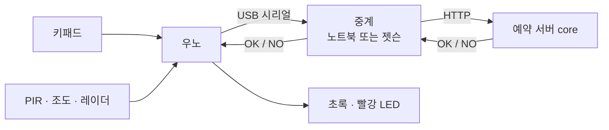

# mspace-device

M-SPACE 디바이스·센서 서비스예요. **문 앞 키패드 체크인**과 **방 안 재실 센서**를 맡아요.

- 담당: 수연
- 팀 공통 문서: [AI-go-do/docs](https://github.com/AI-go-do/docs) (요구사항·컨벤션·인프라)

## 1. 관련 요구사항

| ID | 내용 | 버전 |
|---|---|---|
| FR-ACC-001 | 6자리 번호 → 키패드 체크인 | v0.1 |
| FR-DEV-101 | 재실 센서 값 수집 (레이더·조도·CO2 → 서버) | v0.2 |
| FR-DEV-102 | 방 현황 화면 (지금 비었는지, 다음 예약) | v0.2 |
| FR-DEV-103 | 재실로 노쇼·퇴실 보조 (15분 비면 "퇴실할까요?") | v0.2 |
| FR-DEV-104 | 환기 알림 (CO2 1000ppm) | 확장 |

## 2. 전체 구조



- 우노는 와이파이가 없어서 USB로 노트북에 보내고, 노트북(`gateway/gateway.py`)이 서버에 대신 전달해요.
- **ESP32가 오면** 노트북 없이 ESP32 → 서버로 바로 보내요. 보내는 형식이 같아서 서버는 바뀌지 않아요.
- 번호가 맞는지는 **서버만 판단**해요. 장치는 번호를 저장하지 않고, 입력을 보내고 결과를 표시만 해요.

## 3. 진행 단계

- [ ] **0. 준비:** 아두이노 IDE, Keypad 라이브러리, 우노 업로드 확인
- [ ] **1. 키패드 체크인 (FR-ACC-001):** 6자리 + `#` 입력 → 서버 확인 → LED
- [ ] **2. 센서 수집 (FR-DEV-101):** PIR·조도 값 전송, eventId 중복 제거
- [ ] **3. 레이더 + ESP32:** 가만히 있는 사람 감지, 와이파이 직접 전송
- [ ] **4. 재실 판정:** 15분 연속 없음 = 빈 방, 헷갈리면 "있음". PIR / 레이더 / 둘 다 정확도 비교
- [ ] **5. 방 현황 (FR-DEV-102):** 방별 비었음/사용 중 + 다음 예약
- [ ] **6. 노쇼·퇴실 보조 (FR-DEV-103):** 15분 비면 예약 서버에 알림
- [ ] **7. 확장:** 아래 8절

## 4. 배선도 · 회로도

**꽂기 전에 (고장 안 나게)**
1. USB를 뽑은 상태에서 배선하고, 다 꽂은 뒤 확인하고 연결해요.
2. 5V와 GND를 직접 잇지 않아요 (합선).
3. LED는 꼭 220Ω 저항을 거쳐요. 긴 다리(+)가 핀 쪽, 짧은 다리(−)가 GND 쪽이에요.
4. D0, D1은 비워 둬요. 노트북과 시리얼로 대화하는 핀이에요.
5. 부품은 하나씩 추가하고, 추가할 때마다 시리얼 모니터로 확인해요.

**배선도** (어디에 꽂나)


**회로도** (무엇이 무엇과 이어지나)


| 부품 | 우노 핀 |
|---|---|
| 키패드 핀 1~4 (행1~4) | D11, D10, D9, D8 |
| 키패드 핀 5~8 (열1~4) | D7, D6, D5, D4 |
| 초록 LED (맞음) | D12 → 220Ω → LED → GND |
| 빨강 LED (틀림) | D13 → 220Ω → LED → GND |
| PIR OUT | D2 (VCC 5V, GND) |
| 레이더 OUT (도착 후) | D3 (VCC 5V, GND) |
| 조도 CDS | 5V → CDS → A0 → 10kΩ → GND |

키패드를 눌렀는데 다른 숫자가 찍히면 선을 바꾸지 말고 코드의 `rowPins`, `colPins` 순서만 바꿔요.

## 5. 실행 방법

1. 아두이노 IDE → 라이브러리 관리 → **Keypad** (Mark Stanley) 설치
2. `firmware/uno_sensor_node/uno_sensor_node.ino` 업로드
3. 시리얼 모니터(115200)에서 `123456#` 입력 → keypad JSON이 찍히는지 확인 → **모니터를 닫아요** (중계와 포트를 같이 못 써요)
4. 중계 실행
   ```bash
   pip3 install -r gateway/requirements.txt
   DRY_RUN=1 python3 gateway/gateway.py              # 서버 없이 테스트: 123456#만 초록
   SERVER=http://<core 주소> python3 gateway/gateway.py
   ```
   포트는 자동으로 찾아요. 못 찾으면 `PORT=/dev/ttyACM0`처럼 지정해요.

## 6. 이벤트 형식과 eventId

```json
{"eventId":"1-48213-17","roomId":1,"sensorType":"pir","value":1,"ms":12345}
{"eventId":"1-48213-18","roomId":1,"sensorType":"keypad","code":"123456","ms":12890}
```

- `eventId` = 방 번호 - 켜질 때마다 뽑는 랜덤 번호 - 순서
- 와이파이가 끊겨 중계가 같은 이벤트를 다시 보내도(최대 3번) 서버가 같은 eventId는 **한 번만 저장**해요 (중복 제거)
- 가운데 랜덤 번호는 우노를 껐다 켜서 순서가 0부터 다시 시작해도 번호가 겹치지 않게 해요
- 중계가 서버에 보낼 때 `receivedAt`(받은 시각, UTC)을 붙여요

## 7. 서버와 맞출 것 (core, 지영님과 합의)

| API | 요청 | 정할 것 |
|---|---|---|
| `POST /api/access/verify` | `{roomId, code}` | 응답 형식 (맞음 / 틀림 / 잠김), 장치 토큰 방식 |
| `POST /api/sensor-events` | 위 이벤트 JSON | 누가 만들지, eventId unique 제약 |

## 8. 확장 계획

지금 구조는 **장비만 붙이면 동작하게** 만들어 뒀어요. 같은 이벤트 형식과 같은 API를 쓰기 때문이에요.

| 확장 | 붙일 것 | 바뀌는 곳 |
|---|---|---|
| 환기 알림 (FR-DEV-104) | CO2 센서 (SCD40) | 장치 코드에 센서 읽기만 추가 |
| 실제 도어락 · QR | 릴레이 + 잠금장치, QR 리더 | 같은 `/api/access/verify`를 부르는 장치만 교체 |
| 방마다 설치 | ESP32 + 센서 세트 | 방 번호(`ROOM_ID`)만 바꿔서 복제 |
| 환기 예측 | 젯슨 | CO2 기록으로 "곧 환기 필요" 미리 알림 (팀 결정 대기, Q-10) |

## 폴더 구조

```
firmware/uno_sensor_node/   우노 코드
gateway/                    중계 (노트북·젯슨)
docs/                       배선도·회로도 (png, svg)
```
