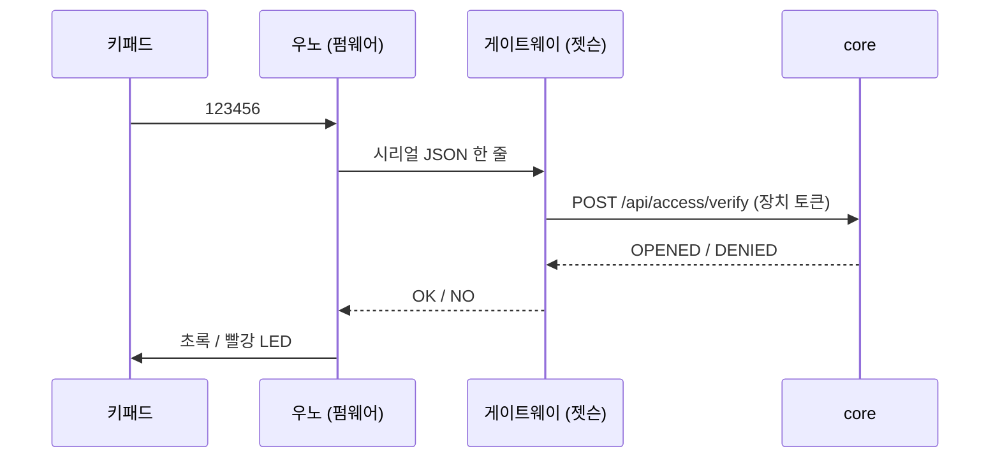

# 키패드 ↔ core 통신 형식 (FR-ACC-001)

> 상태: **초안** · 작성 수연 · 확인 지영(core), 재웅(장치 토큰·요구사항 명세)
> core 쪽 공식 명세는 docs 저장소 [`api/README.md` 6장](https://github.com/AI-go-do/docs/blob/main/api/README.md#6-출입-키패드)이에요 (core `develop`에 구현됨). 이 문서는 **장치 쪽**(우노·게이트웨이)이 그 API를 어떻게 쓰는지 정리해요.
> 4차 회의(11/3) 할 일 "키패드 ↔ core 통신 형식 문서로 남기기". 지금까지 코드에만 있던 약속을 한곳에 모았다.
> ✅ = 코드에 이미 있음 / 🟡 = 제안, 확인 필요

## 1. 전체 흐름



- **판단은 core만 한다.** 장치는 번호를 저장하지 않고, 맞는지 모른다.
- **애매하면 거부한다.** 서버가 답이 없거나 이상한 답이면 게이트웨이는 `NO`를 보낸다.

## 2. 우노 → 게이트웨이 (USB 시리얼) ✅

속도 `115200`, 한 줄에 JSON 하나, 끝은 줄바꿈(`\n`).

```json
{"eventId":"1-1000002-3","roomId":1,"sensorType":"keypad","code":"123456","ms":12890}
```

| 필드 | 형식 | 뜻 |
|---|---|---|
| `eventId` | 글자, `방-bootId-seq` | 이벤트 고유 번호. 아래 4장 |
| `roomId` | 정수 | 방 번호 (펌웨어 `ROOM_ID`) |
| `sensorType` | 글자 | 지금은 `keypad`만. 재실 센서는 `pir`, `light` 등 추가 예정 (FR-DEV-101) |
| `code` | 글자, 숫자 6자리 | 입력한 번호. `0`으로 시작해도 안 사라지게 글자로 보낸다 |
| `ms` | 정수 | 우노가 켜진 뒤 지난 ms. 우노엔 시계가 없어서 참고용 |

게이트웨이 → 우노 답: `OK\n`(열림, 초록 LED) 또는 `NO\n`(거부, 빨강 LED).

## 3. 게이트웨이 → core: `POST /api/access/verify`

### 요청 ✅

```http
POST /api/access/verify
Authorization: Bearer <장치 토큰>
Content-Type: application/json

{"eventId":"67e130b8-f207-50cb-8d21-46c7ff5ac2a5","roomId":1,"deviceId":"keypad-1","code":"123456"}
```

| 필드 | 형식 | 뜻 |
|---|---|---|
| `eventId` | 글자 1~64자 | 우노 `eventId`를 UUID(36자)로 바꾼 값. 중복 거르기용 (4장) |
| `roomId` | 정수 | 방 번호 |
| `deviceId` | 글자 50자 이하 (선택) | `keypad-<roomId>`. 방마다 키패드 1개 |
| `code` | 글자, 숫자 6자리 | 입력한 번호 |

- 요구사항 FR-ACC-001에는 `{roomId, code}`만 적혀 있다. `eventId`·`deviceId`는 지영과 따로 맞춘 것이고 TEAM.md의 `AccessEvent(eventId, roomId, deviceId, ...)`와 같은 이름이다. 🟡 **요구사항 문장도 4개 필드로 고칠지 확인 (재웅, 요구사항 명세 담당)**
- 토큰이 지나가는 길이라 **실제 서버는 HTTPS로만** 부른다. `http://`는 노트북·젯슨 안에서 테스트할 때만 쓴다. 🟡 **개발·운영 서버 HTTPS 주소 확인 (재웅)**
- 장치 토큰은 사람 로그인 토큰(JWT)과 **다른 종류**다. 키패드는 번호 확인만 할 수 있고 예약을 만들 수 없다. 값은 젯슨 `.env`에만 둔다. 🟡 **토큰 발급·형식은 재웅 담당 (4차 회의)**

### 응답

번호를 판단했으면 맞든 틀리든 `200`. 판단 결과는 본문 `result`로 구분한다.

```json
{"result":"OPENED"}
{"result":"DENIED","reason":"WRONG_CODE"}
```

| `result` | `reason` | 언제 | 상태 |
|---|---|---|---|
| `OPENED` | — | 번호 맞음. 처음이면 `BOOKED` → `IN_USE`(체크인), 그 뒤엔 문만 열림 | ✅ |
| `DENIED` | `WRONG_CODE` | 이 방의 유효한 번호가 아님. 다른 방 번호, 예약 끝난 뒤(끝 시각부터), 6자리 숫자가 아닌 `code`, 입실 안 하고 입실 마감이 지난 경우(미리 예약은 시작 + 15분, 지금 바로 쓰기는 누른 뒤 10분, core #40 노쇼) 포함 | ✅ core |
| `DENIED` | `NOT_YET` | 시작 10분 전이 아직 안 됨 | ✅ core |
| `DENIED` | `LOCKED` | 5번 연속 틀려서 1분 잠김 | ✅ core |

- 이미 입실한 사람은 끝 시각 전까지 같은 번호로 다시 열 수 있다 (`OPENED`, 체크인은 다시 안 함).
- `400`은 `eventId`·`roomId` 문제일 때만이다. `code` 형식이 틀리면 `400`이 아니라 `WRONG_CODE`다.
- 게이트웨이는 `OPENED`가 아니면 모두 `NO`로 처리한다. 그래서 `reason` 이름이 바뀌어도 장치는 안 깨진다. `reason`은 로그와 나중에 LED 표시를 다르게 할 때 쓴다.
- 5회 잠금은 core가 센다 (`LOCKED`). 장치는 재부팅되면 횟수를 잃고, 키패드가 여러 대여도 core는 하나라서 이 방식이 맞다.

### 오류 (판단 전에 막힌 경우)

팀 컨벤션대로 `{"code": "...", "message": "..."}`.

| 상태 | 언제 | 게이트웨이 동작 |
|---|---|---|
| `400` `INVALID_REQUEST` | `eventId`·`roomId` 빠짐, 길이 넘음 | 다시 안 보냄, `NO` |
| `401` `DEVICE_UNAUTHORIZED` | 장치 토큰 없음·틀림 | 다시 안 보냄, `NO` |
| `5xx`, 연결 실패, 2초 안에 답 없음 | 서버 문제 | 같은 `eventId`로 최대 2번 (1초 쉬고) → 그래도 안 되면 `NO`. 최대 약 5초 |

## 4. eventId와 중복 거르기

- 우노가 `방-bootId-seq`로 만든다. `seq`는 켜진 뒤 몇 번째 입력, `bootId`는 몇 번째로 켜졌는지(EEPROM에 저장, 켤 때마다 +1).
- `bootId`는 **따로 보내는 필드가 아니라 eventId 안에 들어 있다.** 재부팅으로 `seq`가 1부터 다시 시작해도 `bootId`가 달라서 eventId가 안 겹친다.
- 게이트웨이가 `uuid5(uuid5(NAMESPACE_DNS, "mspace-device"), "1-1000002-3")`으로 UUID를 만든다. 같은 입력이면 항상 같은 UUID라서 재전송해도 eventId가 같다.
- core는 같은 eventId가 다시 와도 한 번만 처리하고, **처음 결과를 그대로 돌려준다** ✅ (core `access_event` 표에 eventId별 `result`·`reason` 저장). 그래서 재전송해도 체크인이 두 번 되지 않고 잠금 횟수도 다시 세지 않는다.
- 🟡 **보관 기간**: 지금은 지우는 작업이 없어 계속 남는다. 재전송은 최대 약 5초 안에 끝나므로 하루 지나면 지워도 된다고 제안 (지영 답 기다림).

## 5. 지영·재웅에게 확인할 것

| # | 질문 | 누구 |
|---|---|---|
| 1 | 요청 4개 필드로 요구사항 문장 고치기 (요구사항 명세 담당) | 재웅 |
| 2 | ~~같은 eventId 재요청 시 처음 결과 그대로?~~ ✅ 그렇다. 남은 것: 보관 기간(하루 제안) | 지영 |
| 3 | 장치 토큰 발급 방법과 테스트용 개발 서버 주소 (HTTPS) | 재웅 |
