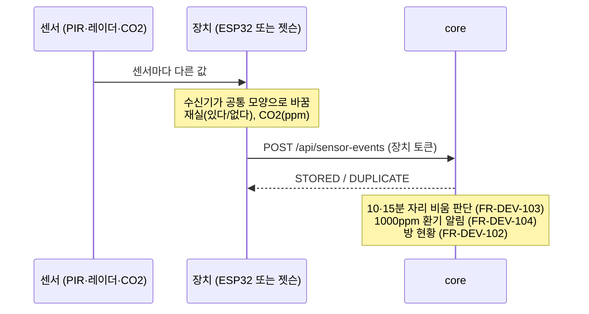

# 재실 · CO2 센서 → core 통신 형식 (FR-DEV-101~104)

> 상태: **초안** · 작성 수연 · 확인 지영(core), 재웅(장치 토큰)
> docs `api/README.md` 8장 "재실 센서 이벤트 API: 명세 없음" 자리를 채우려는 제안이에요. 강사님 멘토링(11/4) "서비스마다 API 명세부터 먼저"에 따라, 센서가 오기 전에 형식부터 맞춰요.
> 키패드 형식([access-api.md](access-api.md))과 같은 규칙(장치 토큰, `eventId` 중복 거르기, 4xx는 다시 안 보냄)을 그대로 써요.
> ✅ = 요구사항에 이미 있음 / 🟡 = 제안, 확인 필요

## 1. 한눈에



- **장치는 "지금 어떤지"만 알린다. "그래서 어떻게 할지"는 core가 정한다.** 10분·15분 판단, 알림, 자동 퇴실은 모두 core가 한다 ✅ (FR-DEV-103)
- **센서 종류는 장치 안에서 숨긴다.** core는 PIR인지 레이더인지 몰라도 된다. 센서를 바꾸거나 새로 붙여도 core는 안 고친다 🟡 (3장)

## 2. 요청: `POST /api/sensor-events` 🟡

```http
POST /api/sensor-events
Authorization: Bearer <장치 토큰>
Content-Type: application/json
```

- 운영에서는 **`https://`로만** 보낸다. 장치 토큰이 헤더에 실리기 때문이다. `http://`는 맥에서 로컬로 띄운 테스트에서만 쓴다 🟡
- **장치 토큰 하나 = 장치 하나 = 방 하나.** core는 토큰으로 어느 장치·방인지 알고 있다. 요청의 `roomId`·`deviceId`가 토큰에 등록된 값과 다르면 거부한다(4장 `403`). 토큰 하나를 훔쳐도 다른 방 상태를 바꿀 수 없다 🟡

### 2-1. 재실 (`OCCUPANCY`)

```json
{
  "eventId": "2f1c6b9e-6d0a-5a77-9a52-0c1f3c1d8e41",
  "roomId": 1,
  "deviceId": "sensor-1",
  "kind": "OCCUPANCY",
  "occupied": false,
  "sources": { "pir": false, "radar": false },
  "observedAt": "2026-11-04T14:05:00+09:00"
}
```

| 필드 | 형식 | 뜻 |
|---|---|---|
| `eventId` | 글자 1~64자 | 이벤트 고유 번호. 키패드와 같이 UUID. 다시 보내도 같은 값 (5장) |
| `roomId` | 정수 | 방 번호 |
| `deviceId` | 글자 50자 이하 | 보낸 장치. 예: `sensor-1` (1번 방 센서 장치) |
| `kind` | `OCCUPANCY` | 재실 이벤트 |
| `occupied` | 참/거짓 | **장치가 합친 최종 판단.** 센서 중 하나라도 "있음"이면 `true` ✅ (FR-DEV-103 "PIR·레이더 중 하나라도 있음이면 있음") |
| `sources` | 객체, 선택 | 센서별 값. core는 판단에 안 쓰고 기록만 해요. 정확도 측정(PIR vs 레이더, 이슈 #13)에 써요 |
| `observedAt` | 시각 `+09:00` | 센서가 본 시각. 와이파이가 끊겼다 다시 보내도 core가 실제 시각으로 계산하게 |

**언제 보내나**
- `occupied`가 **바뀔 때** 바로 보낸다 ✅ (FR-DEV-101)
- 바뀌지 않아도 **10초마다 한 번** 지금 상태를 다시 보낸다 🟡 (살아 있다는 신호, 이슈 #8). 끊김을 1분 안에 알아채서 10분 자리 비움 알림보다 먼저 판단할 수 있다. core는 같은 상태가 다시 와도 "바뀜"으로 보지 않는다.

### 2-2. CO2 (`CO2`)

```json
{
  "eventId": "9a0e3f55-1b2c-5d6e-8f90-a1b2c3d4e5f6",
  "roomId": 1,
  "deviceId": "sensor-1",
  "kind": "CO2",
  "ppm": 1080,
  "source": "scd40",
  "observedAt": "2026-11-04T14:06:00+09:00"
}
```

| 필드 | 형식 | 뜻 |
|---|---|---|
| `kind` | `CO2` | CO2 측정값 |
| `ppm` | 정수 0~10000 | CO2 농도 |
| `source` | 글자, 선택 | 센서 이름. 예: `scd40`, 실습 센서 이름, 가상 센서는 `virtual`. core는 `source` 칸에 저장 (재실의 `sources` 객체와 다른 칸) |

**언제 보내나**: **1분마다** 🟡. 판단(1000ppm 넘었는지)은 core가 한다.

## 3. 장치 안: 수신기 인터페이스 🟡

강사님 조언(11/4): 센서마다 데이터 모양이 다르니 **공통 인터페이스 + 센서별 수신기**로 나눈다.

| 공통 인터페이스 | 수신기 (센서별) | 센서가 주는 값 | 수신기가 바꾼 값 |
|---|---|---|---|
| 재실 받기 | PIR 수신기 | 움직이면 HIGH | 있다/없다 |
| 재실 받기 | 레이더 수신기 (LD2410C) | OUT 핀 HIGH (가만히 있어도 유지) | 있다/없다 |
| CO2 받기 | SCD40 수신기 | I2C 값 | ppm |
| CO2 받기 | 실습 센서 수신기 | (센서에 따라) | ppm |
| CO2 받기 | 가상 CO2 수신기 | 만들어 낸 값 (시연·테스트) | ppm |

- 새 센서를 붙이면 수신기 하나만 추가한다. core API와 다른 수신기는 그대로다.
- 장치가 PIR·레이더를 합쳐 `occupied` 하나로 보낸다. 그래서 core는 "센서 여러 개 합치기"를 몰라도 된다.

## 4. 응답 🟡

키패드와 같이 **처리했으면 `200`**. 본문은 아래 둘 중 **하나**다.

처음 받은 이벤트:
```json
{ "result": "STORED" }
```

같은 `eventId`가 이미 있음 (장치는 성공으로 보고 끝낸다):
```json
{ "result": "DUPLICATE" }
```

| 오류 | 상태 | 언제 | 장치 동작 |
|---|---|---|---|
| `DEVICE_UNAUTHORIZED` | 401 | 장치 토큰 없음·틀림 | 다시 안 보냄, 로그 |
| `DEVICE_ROOM_MISMATCH` | 403 | 토큰에 등록된 방·장치와 `roomId`·`deviceId`가 다름 | 다시 안 보냄, 로그 (설정 실수) |
| `INVALID_REQUEST` | 400 | 빠진 값, 모르는 `kind`, `ppm` 범위 밖, 오프셋 없는 시각 | 다시 안 보냄, 로그 |
| `5xx`, 연결 실패 | - | 서버 문제 | 같은 `eventId`로 다시 보냄 (키패드와 같은 재시도) |

오류 본문은 docs `api/README.md` 공통 규칙과 같이 `code`·`message`를 쓴다. 예:

```json
{ "code": "DEVICE_ROOM_MISMATCH", "message": "이 장치는 이 방에 등록되지 않았습니다" }
```

## 5. 중복 거르기 · 끊김 🟡

- 키패드와 같다. 장치가 `eventId`를 만들고, 재전송해도 같은 값. core는 `eventId` **unique 제약**으로 한 번만 저장한다 (이슈 #7).
- 와이파이가 끊긴 동안의 이벤트는 장치가 모아 뒀다가 순서대로 보낸다.
- **늦게 온 이벤트**: 재전송·지연으로 도착 순서가 `observedAt` 순서와 다를 수 있다. 그래서 core는 이렇게 한다.
  - 모든 이벤트는 저장한다(기록·정확도 측정용).
  - 방의 지금 재실 상태는 **`observedAt`이 지금 상태보다 새로울 때만** 바꾼다. 더 오래된 이벤트는 저장만 하고 상태를 덮지 않는다.
  - `observedAt`이 같으면 먼저 저장된 것(`received_at` 순)을 따른다.
  - 10·15분 타이머는 "비어 있음이 된 `observedAt`"부터 잰다. 받은 시각이 아니다.
  - CO2 "3분 연속"도 `observedAt` 순서로 본 최근 3개 값으로 판단한다. 단 **이웃한 값의 간격이 30초 이상 90초 이하일 때만** 연속으로 센다(1분 주기 ± 여유 30초). 같은 시각이거나 30초보다 가까운 값은 연속 판정에 넣지 않는다. 또 **첫 값과 마지막 값이 100초 이상** 떨어져 있어야 한다(1분 주기 2칸 = 120초에서 여유 20초). 그래서 30초 간격 값 3개처럼 1분 만에 "3분 연속"이 되는 일은 없다. 간격이 더 벌어지면(끊겼다 복구 등) 처음부터 다시 센다. 이미 지난 알림 시각보다 오래된 값은 새 알림을 만들지 않는다.
  - `observedAt`이 지금보다 5분 넘게 미래면(장치 시계 오류) `400 INVALID_REQUEST`.
- **센서 끊김**: 한 방에서 **1분 동안** 재실 이벤트가 하나도 안 오면 core는 그 방을 **"있음"**으로 본다 ✅ (FR-DEV-101 "틀리면 있음 쪽으로"). 10초마다 보내는 신호(2-1)가 6번 빠지면 끊긴 것으로 본다. 끊겨서 자동 퇴실되는 일은 없다.

## 6. core가 하는 일 (지영님 확인) 🟡

| 할 일 | 요구사항 | 제안 |
|---|---|---|
| 이벤트 저장 | FR-DEV-101 | 표 `sensor_event` (`event_id` unique, `room_id`, `device_id`, `kind`, `occupied`, `sources`(재실, JSON), `ppm`, `source`(CO2 센서 이름), `observed_at`, `received_at`) |
| 방 지금 상태 | FR-DEV-102 | 방별 마지막 재실 상태와 바뀐 시각. 방 현황 화면·비서 `room_status` 도구가 읽음 |
| 자리 비움 | FR-DEV-103 | `IN_USE` 예약이 있는 방이 "비어 있음"이 된 시각부터 10분 → 알림, 15분 → `AWAY_RELEASED` |
| 환기 알림 | FR-DEV-104 | 1000ppm 넘는 값이 **3분 연속**(1분마다 3번)이면 알림. 잠깐 튀는 값은 무시. 같은 방 30분에 한 번 ✅ |

- 시계열 저장(InfluxDB)은 나중에 붙인다. 지금은 core DB 표 하나로 충분하다 (강사님: 인프라는 최소로).

## 7. 정할 것

| 누구 | 질문 |
|---|---|
| 지영 | 이 API를 core에 두는 게 맞는지, 경로 `/api/sensor-events` 괜찮은지 |
| 지영 | 응답을 `200` + `STORED`/`DUPLICATE`로 하는 게 괜찮은지 (키패드처럼) |
| 지영 | 끊김 판단 1분(10초 신호 6번), CO2 "3분 연속" 기준 |
| 재웅 | 센서 장치(ESP32)용 장치 토큰을 키패드와 따로 받을지. 장치 하나에 토큰 하나, 토큰마다 방·장치 등록 (2장) |
| 수연 | 실습 센서 중 무엇을 쓸지 (CO2·재실). 정해지면 3장 수신기 표에 넣기 |
